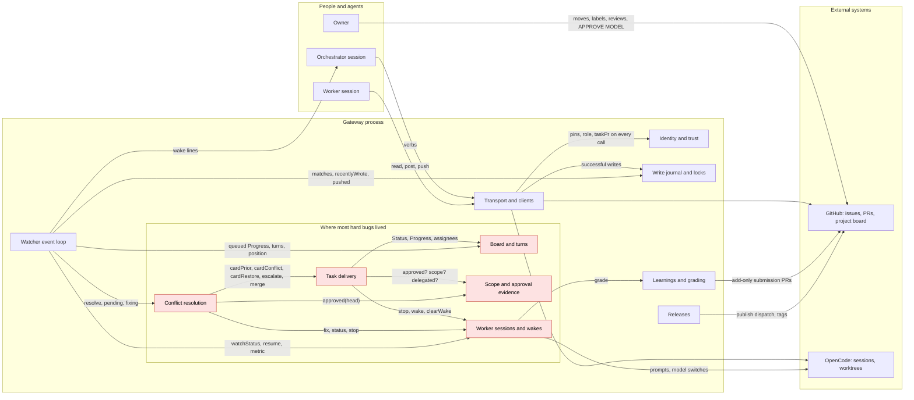

# The emerged architecture

Name the concepts the gateway actually implements, state the rules it must never break, show where the code diverges from that model, and lay out a staged, behaviour-preserving path to a structure that matches it.

Status: **analysis for issue #385**, read-only against `dev` at `179a981`. The agreed design is still [architecture.md](architecture.md); this document describes what about 500 commits of incident-driven patches turned that design into, and proposes how to make it explicit without losing any of the hard-won behaviour. Line numbers refer to `dev` at that commit and will drift; the function names will not.

## Reading guide

| Section                                                                 | Answers                                                                           |
| ----------------------------------------------------------------------- | --------------------------------------------------------------------------------- |
| [1. The emerged model](#1-the-emerged-model)                            | Which concepts exist, what each owns, and where its state lives                   |
| [2. Invariants](#2-invariants)                                          | Per concept, the rules that must hold, each traced to the incident that taught it |
| [3. How the concepts interact](#3-how-the-concepts-interact)            | The data and events crossing between them, and where the hard bugs lived          |
| [4. Where the code diverges](#4-where-the-code-diverges-from-the-model) | Duplication, implicit state machines, literals, legacy paths, mixed modules       |
| [5. The target structure](#5-the-target-structure)                      | Modules aligned to the concepts, their public interfaces, the thin handler layer  |
| [6. A staged plan](#6-a-staged-plan)                                    | Ordered, independently releasable steps of at most 5 points each                  |
| [7. What not to change](#7-what-not-to-change)                          | Behaviours that look accidental but are load-bearing                              |

The code under discussion is `src/gateway/` (55 files, about 24,000 lines), `src/board/` and `src/cli/`. Four files carry most of it: `events.ts` (4,355 lines), `server.ts` (3,201), `workers.ts` (2,098) and `task-flow.ts` (1,929). The test suites mirror them: `events.test.ts` (4,191), `task-flow.test.ts` (4,596), `workers.test.ts` (3,686).

## 1. The emerged model

The design document named four ideas: the board as state, the gateway as the single trust boundary, journaled operations, and turn-based handoffs. The code implements twelve concepts. The task's starting list is confirmed with three changes: _journals and locks_ split into a transport-boundary journal and a family of locks with different staleness rules; _the watcher's event loop_ turns out to own a second, file-based state store that mirrors GitHub; and _config and distribution_ (schema, launcher, stubs, self-hosting) is a concept of its own that the other eleven depend on.

### 1.1 Identity and trust

**Responsibility.** Decide who is speaking and what that identity may do, before any text is read or any write is attempted.

**Owns.** `people.yaml` pins (login, numeric id, account type, role, `repos` binding, system `events`/`appIds`); `PeopleFilter` (`src/gateway/people.ts`: `identity`, `accept`, `check`, `roleIn`); token identity (`identity.ts`: `tokenViewer`, `tokenIdentity`; `github-token.ts`); the call context (`transport.ts:164-174`: role and `taskPr` from the environment); the operation policy table and `authenticate` (`server.ts:3094-3152`, `:116-147`); the dropped digest (`digest.ts`).

**State.** The reloadable people list (reloaded at poll boundaries, `server.ts:705-719`); one cached viewer lookup per process (`server.ts:117`); `dropped.jsonl` under the state root.

**Key rules.** Authority is the lower of the token's pinned role and `VMETHOD_ROLE`; a task-scoped session must hold a worker token; the orchestrator role exists only in the repositories the binding lists; an edited comment belongs to its editor.

### 1.2 The gateway boundary: transport and clients

**Responsibility.** Be the only code that touches GitHub, OpenCode and git credentials; decode responses strictly; pace against the account budget; record every successful write.

**Owns.** `Operations` and `inProcess` (`transport.ts`); `GitHubClient` (`client.ts:92-460`: request, retry, budget headers, secondary limits, `BudgetPause`, the write journal hook at `:337` and `:352`); `OpencodeClient` (`client.ts:520-914`: sessions, permissions, messages, usage, `worktree gone`); `GitTransport` (`git.ts`: fetch/push with classified failures, merge preview); the Markdown and closing-keyword guards (`markdown.ts`); the diagnostic filter for `gh-read` (`queries.ts`).

**State.** Per-resource budget headers and `pauseUntil` (`client.ts:96-105`); the retry log inside a poll (`watch-retries.log`); nothing else. Credentials never leave this layer.

### 1.3 The board and turns

**Responsibility.** Keep each card's Status, Progress, management assignee and position consistent with the protocol, so the board is the state and the assignee is "whose move it is".

**Owns.** The seven columns (`board/runner.ts:21-29`); the Progress grammar (`board/progress.ts`); turn rules (`turn.ts`: `turnAssignees`, `setTurn`, `ownerForTurn`); `BoardService` writes with their ordering and card-order hooks (`board.ts:605-969`); the README version block and migrations (`board/readme.ts`, `board/runner.ts`, `board/migrations/`).

**State.** The GitHub project itself; the README block (version, lock, aliases, in-flight archived move); the watcher's per-card baselines (`board/<item id>`, `.who`, absences) described in 1.8.

**Key rules.** A Status write always carries Progress, in one ordered mutation with Progress first; the management assignee is a function of Progress state; worker assignees are never touched; writes are scoped to the configured repository; migrations are append-only, locked, verified and never downgrade.

### 1.4 Scope and approval evidence

**Responsibility.** Turn GitHub history into yes/no/unknown answers about owner decisions: scope approved, delivery approved, approval carried, delegation active, model authorized, summons released.

**Owns.** `scope.ts` (`scopeApproved`, `reviewPending`, `scopeRefusal`, `ScopeReader`); `approval.ts` (`isOwnerApproved`, `approvalRefusal`, `isIssueOwnerApproved`); `autopilot.ts` (`autopilotStates`, `inheritAutopilot`, `taskGroupNumbers`); `model-gate.ts`; `owner-agreement.ts`; the proofs `clean-base.ts`, `carry-approval.ts`, `conflict-proof.ts`; their server-side readers `approvalFor`, `autopilotApprovalFor`, `modelApproval`, `ownerCardModel` (`server.ts:2909-3029`, `:1623-1665`, `:1810-1900`).

**State.** None of its own. Every answer is recomputed from GitHub evidence: review objects, project status-change timeline events with their actor, label events, comment bodies behind identity checks, body hashes, and the `creator` of a project field value. The one local artefact is the read-body hash in `.tmp/issue-read-<n>.sha256` that `issue edit` uses as a stale-read guard.

### 1.5 Task delivery

**Responsibility.** Open, review, hand over, merge and close one delivery, applying the gates in the right order and leaving a journal that can resume.

**Owns.** `TaskFlow` (`task-flow.ts`: `open`, `review`, `ask`, `release`, `merge`/`mergePr`, `close`, `link`, `openPr`); task markers (`task-flow-types.ts`: `taskIssueNumbers`, `taskRelation`, `taskModelOverride`, `isTaskPrompt`; `task-hold.ts`); the push policy (`server.ts:2655-2799`); CI evidence (`checks.ts`); integration verification and `refresh-checks` (`verify.ts`).

**State.** PR body markers (`# Task:` header, `points_open`, `vmethod-task`, `vmethod-autopilot-copy`, the hold banner); the merge journal `merge-<pr>.json` (`task-flow.ts:84-92`, `:1641-1817`); thread snapshots in `.tmp/`.

### 1.6 Worker sessions

**Responsibility.** Run one OpenCode session per task PR in a worktree of the worker checkout; deliver wakes exactly once; switch models with usage accounting; recover from quota stops; grade the delivery.

**Owns.** `WorkerService` (`workers.ts`); `WorkerWorktrees` (`worker-launch.ts`); `WorktreeService` cleanup (`worktrees.ts`); the first prompt (`worker-prompt.ts`); `cost.ts` and `learning-metrics.ts` for the per-segment accounting.

**State.** `workers/<pr>.json` (`Session`, `workers.ts:93-119`: id, directory, model, segments with baselines and request caches, `pendingWake`, `pendingConflict`, `conflictModel`, `conflictSentAt`, `quotaStop`, `quotaResume`, `usageCaptured`, `finalized`, `gradePosted`, metric events); `<pr>.wake` (wakes persisted under lock contention); `<pr>.lock`; `quota-<family>.json`; `.vmethod/.env` in the worktree.

### 1.7 Conflict resolution

**Responsibility.** When a task PR conflicts with its base, or the base moved, get it current without losing an owner approval or a review round, and prove the resolution touched only the conflict.

**Owns.** `ConflictService` (`conflicts.ts`: `resolve`, `guard`, `recover`, `pending`, `fixing`); the card side in `TaskFlow` (`cardPrior`, `cardConflict`, `cardRestore`, `escalateConflict`, `conflictTask`, `pullLifecycle`); the fixer side in `WorkerService` (`resolveConflict`, `conflictChoice`, `restoreConflictModel`, `conflictLine`); the watcher driver `reconcileConflicts`/`settleConflicts` (`events.ts:1641-1707`).

**State.** `conflicts/<pr>.json` (`Resolution`, `conflicts.ts:35-54`: head, base, files, step 1–3, phase `starting|waiting|resolved|blocked|merged`, `prior` card, `dispatched`, `restored`); `conflicts/<pr>.lock` (owned by pid and process start); watcher markers `conflict-<pr>`, `conflict-dispatched-<pr>-<sha>`, `base-dispatched-…`, `conflict-result-…`.

### 1.8 The watcher's event loop

**Responsibility.** Observe GitHub and OpenCode on a budget, turn changes into metadata-only wake lines for one orchestrator session, keep the board's turn bookkeeping honest, and never lose or duplicate an event across restarts.

**Owns.** `EventLoop` (`events.ts`): the lock, the long poll and acknowledgement (`:489-600`), the pending/quiet/once machinery (`:625-874`), eight poll steps (`runPoll`, `:1354-1417`), the conflict driver, the comment-to-protocol stream (`processComment`, `:2166-2375`), the board poll (`pollBoard`, `:2580-2798`), worker and quota polls, budget pacing; `WatchBoard`, `WatchPacing`, `WatchDelivery`, `watch-scope.ts`, `watch-stop.ts`.

**State.** A per-session directory under `$XDG_STATE_HOME/vmethod/<stateName>` holding roughly forty marker kinds (listed in 4.2), `pending.json`, `quiet`, `cursor`, `listing-baseline`, `mutes`, `tracks`, `delivered.jsonl`, `writes.jsonl`, and `board/` baselines. This is a second state store that shadows GitHub so the watcher can tell news from noise.

### 1.9 Journals and locks

**Responsibility.** Attribute writes to the session that made them, keep multi-field operations invisible while in flight, and make every concurrent process hold a lock whose staleness can be decided.

**Owns.** `WriteJournal` (`write-journal.ts`: `record` at the client boundary, `matches`, `beginOperation`, `recentlyWrote`, `recordPush`/`pushed`); `lock-holder.ts` and `process-identity.ts`; the lock in each concept: watcher (`events.ts:937-1006`), conflict (`conflicts.ts:254-346`), worker (`workers.ts:488-512`), journal (`write-journal.ts:213-265`), migration (`board/runner.ts:218-303`, a project field), learnings and generation (`learnings.ts:315-331`, `learning-annotations.ts:217-230`), review worktree (`verify.ts:40-50`).

**State.** `writes.jsonl` with 24-hour retention; the lock files and directories above.

### 1.10 Learnings and grading

**Responsibility.** Record what each delivery cost and how it went, in a shared schema; share it through add-only fork PRs; distil advice that never becomes policy by itself.

**Owns.** `grade` (`workers.ts:1884-2065`); `src/learnings.ts` (schema validation, report); `LearningsService` (`gateway/learnings.ts`: submit, show, report, `records`, `familyEvidence`, `unionRecords`); `LearningAnnotations`; `learning-policy.ts`, `learning-check.ts`, `learning-merge.ts`; `privateLearning`.

**State.** `.vmethod/model-log.jsonl` (local staging); `learnings.json` receipt; `learnings/models/**` and `learnings/notes/**` in the central repository.

### 1.11 Releases

**Responsibility.** Publish a release candidate from a quiet base with provenance, and move the board schema with it.

**Owns.** `release.ts` (`releaseNext`); `scripts/changelog.mjs`, `release-notes.mjs`, `publish.mjs`; `board/migrations/` as release artefacts with the `adoption` contract guard (`board.ts:1014-1075`); `learning-merge.ts` as the pre-release step.

**State.** Git tags, GitHub releases, the npm `next` dist-tag, `package.json#boardVersion`.

### 1.12 Config and distribution

**Responsibility.** Validate the three project files, map environment overrides, resolve the checkout, and make every command run that checkout's own install.

**Owns.** `config.ts`, `check.ts`, `init.ts`, `registry.ts` (stubs and launcher), the schemas, `worker-path.ts`, the self-hosting detection scattered through `events.ts:504-521`, `workers.ts:1276-1294`, `worker-launch.ts:197-206`.

**State.** None at run time; `Config` is an untyped record (`config.ts:13`).

## 2. Invariants

Each rule names the incident that taught it. Where the incident is a PR without a separate issue, the PR number is given. "Must" means a test exists or should exist; the staged plan in section 6 adds the missing ones before any restructuring.

### 2.1 Identity and trust

| #   | Invariant                                                                                                                                                     | Taught by                 | Enforced at                                                                    |
| --- | ------------------------------------------------------------------------------------------------------------------------------------------------------------- | ------------------------- | ------------------------------------------------------------------------------ |
| I1  | Authority comes from the token's pinned numeric identity; the environment can only narrow it, and a task-scoped call must hold a worker token.                | #66 (PR #67)              | `server.ts:116-147`, `transport.ts:164-174`                                    |
| I2  | A protocol tag, display name, commit author or card Status never confers authority; only `people.yaml` pins do, matched on id, type and login.                | design (#2, #19)          | `people.ts:97-119`, `queries.ts:548-609`                                       |
| I3  | The orchestrator role is per repository; a peer project's orchestrator is a collaborator here: no amendments, answers, GO, handovers or turns.                | #186 (PR #196), #201      | `people.ts:47-52`, `turn.ts:17-20`, `events.ts:2224`, `scope.ts:24-28`         |
| I4  | An edited item belongs to its editor; an unverifiable editor fails closed. REST cannot name the editor, so edited REST text is never relayed as instructions. | #19, #53                  | `people.ts:58-62`, `queries.ts:585-599`, `events.ts:2216-2221`                 |
| I5  | Unknown authors are dropped before their bodies are fetched, and counted in the digest; scope and autopilot readers filter metadata before body reads.        | design (#4), #45 (PR #53) | `server.ts:2010-2052`, `scope.ts:271-303`, `autopilot.ts:123-137`, `digest.ts` |
| I6  | System identities yield structured facts only, matched by application id, never by check name or comment text.                                                | design (#2)               | `people.ts:78-93`, `checks.ts:229`, `people.ts:138-161`                        |
| I7  | `GH_TOKEN` is never read; the gh login in `GH_CONFIG_DIR` is the only credential, and each checkout carries its own identity.                                 | #285                      | `github-token.ts`, `check.ts:29-31`                                            |
| I8  | A worker may post, wait and push only on its own task PR in the configured repository.                                                                        | #7, #23                   | `server.ts:3185-3197`, `server.ts:2693-2697`                                   |

### 2.2 The gateway boundary

| #   | Invariant                                                                                                                                           | Taught by             | Enforced at                                                          |
| --- | --------------------------------------------------------------------------------------------------------------------------------------------------- | --------------------- | -------------------------------------------------------------------- |
| G1  | Only a successful, complete response is journaled as a write; a refused or partial GraphQL mutation never stamps.                                   | #55 (PR #56), #113    | `client.ts:346-353`                                                  |
| G2  | Budget comes from response headers, never the `rateLimit` field; the client pauses before the reserve, and a watch poll raises instead of sleeping. | design (#2, #6), #364 | `client.ts:231-266`, `:200-203`, `watch-pacing.ts:14`                |
| G3  | A transient retry inside a watch poll is logged, not printed; an exhausted retry still surfaces.                                                    | #273 (PR #277)        | `client.ts:134-177`                                                  |
| G4  | Malformed shapes fail closed: invalid pagination cursors, missing connections and non-object payloads throw rather than yielding empty data.        | tooling-rules, #45    | every `pageInfo` check, e.g. `board.ts:64-74`, `server.ts:2038-2051` |
| G5  | Credentials and unfiltered responses never cross the operation seam; subprocess environments are allowlisted.                                       | design (#4), #285     | `git.ts:160-173`, `lockfile.ts:44-52`, `worker-launch.ts:270`        |
| G6  | Every post is checked Markdown with no closing keyword and no duplicated protocol header, and the file content is sent verbatim with no footer.     | #4, #268, #266        | `markdown.ts`, `server.ts:2494-2496`, `worker-verbs.ts:91-106`       |

### 2.3 The board and turns

| #   | Invariant                                                                                                                                                                                                     | Taught by                            | Enforced at                                                    |
| --- | ------------------------------------------------------------------------------------------------------------------------------------------------------------------------------------------------------------- | ------------------------------------ | -------------------------------------------------------------- |
| B1  | Every Status write carries a Progress value in the same ordered mutation, Progress first; verbs write assignees before the board move.                                                                        | PR #178, #199 (PR #235)              | `board.ts:625-642`, `:788-798`, `task-flow.ts:1018-1050`       |
| B2  | The management assignee is a function of Progress: `👤…` holds the owner, worker-protocol states and `🧭🔍` hold the orchestrator, `🤖🔨` or empty holds nobody; worker assignees are never added or removed. | PR #79, #257 (PR #259)               | `events.ts:3699-3724`, `board.ts:848-857`, `turn.ts:21-24`     |
| B3  | A verb that writes several fields records an operation first; the watcher's violation and autopilot checks skip a card in that two-minute window.                                                             | #199, #249, #253                     | `write-journal.ts:91-126`, `events.ts:2992-3029`, `:3729-3732` |
| B4  | A card's current Status is never approval; only a timeline event with an owner actor or an owner review is.                                                                                                   | design (#17, #19)                    | `approval.ts:159-297`                                          |
| B5  | An orchestrator's own handover comment applies its Progress change once per comment, never on every re-read of the cursor window.                                                                             | #126 (PR #127)                       | `events.ts:2245-2268`                                          |
| B6  | A card whose Status reads empty while its baseline holds a column is unknown for that poll; a baseline is pruned only after three successful polls spanning 24 hours.                                         | #216 (PR #232), #206 (PR #210)       | `events.ts:3249-3254`, `:2810-2843`                            |
| B7  | A move observed in a listing is re-read before it is reported; a stale read never replaces the baseline, and only an authenticated person's newer move cancels a turn.                                        | #164 (PR #165), #175 (PR #178)       | `events.ts:3275-3337`, `:3524-3573`                            |
| B8  | Owner self-unassignment returns the turn to the orchestrator with `🧭🔍`; a plain owner comment never releases a summons.                                                                                     | #223 (PR #224)                       | `events.ts:3227-3233`, `applyProgress` `:3626-3634`            |
| B9  | Linked issues wait in Executing with no owner mirror; owner states live on the task PR only.                                                                                                                  | #106 (PR #109), #223                 | `events.ts:3752-3802`, `task-flow.ts:1051-1055`                |
| B10 | Only Executing (top on activity) and Owner review (bottom on handover) are reordered; owner-ordered columns are never moved; position writes are best effort.                                                 | #238 (PR #240)                       | `board.ts:892-969`                                             |
| B11 | Ordinary writes are scoped to the configured repository and refuse foreign or draft cards; only migrations act board-wide; Done keeps six across repositories.                                                | design (#5), #87                     | `board.ts:514-518`, `:585-603`, `:531-536`                     |
| B12 | Migrations are append-only, locked on a project field, idempotent, verified after each version and never downgrade; option-list writes keep IDs and verify every card's value.                                | #22, #83, #234, #252, #258 (PR #258) | `board/runner.ts:305-435`, `:706-752`                          |
| B13 | An archived card is never written directly; a changed value goes through journaled unarchive, set, archive and verify.                                                                                        | #258, #267 (PR #269)                 | `board.ts:660-686`, `board/runner.ts:527-564`                  |
| B14 | Membership and per-item writes read the issue side, never the eventually consistent project listing; the listing is for board-wide scans only.                                                                | #168 (PR #188), #287 (PR #296)       | `board.ts:566-583`, `:764-772`                                 |

### 2.4 Scope and approval evidence

| #   | Invariant                                                                                                                                                                                                               | Taught by                            | Enforced at                                                    |
| --- | ----------------------------------------------------------------------------------------------------------------------------------------------------------------------------------------------------------------------- | ------------------------------------ | -------------------------------------------------------------- |
| S1  | Scope is approved only by an owner move Spec review → Executing (or Scoping → Executing for the trivial shortcut) newer than the latest SCOPE REVIEW whose hash matches the current body.                               | #138 (PR #140), #223                 | `scope.ts:31-131`                                              |
| S2  | Editing the body voids scope approval, and the edit says so at edit time, not at merge time.                                                                                                                            | #359 (PR #375), #341                 | `server.ts:1130-1147`, `scope.ts:168-178`                      |
| S3  | Any comment by someone who is not this repository's orchestrator voids the trivial shortcut.                                                                                                                            | #138, #186                           | `scope.ts:76-78`                                               |
| S4  | A delivery is approved by an owner review on the exact head, or an owner move to Approved from Owner review after an OWNER REVIEW naming that head; an edit cannot backdate a handover.                                 | design (#17), #19, #88 (PR #89)      | `approval.ts:159-297`                                          |
| S5  | A historical approval survives later moves by non-owners; an owner's own later move away from Approved revokes it.                                                                                                      | #88 (PR #89)                         | `approval.ts:179-235`                                          |
| S6  | Approval carries across base merges only with proof: every task-side commit is a two-parent base merge (`cleanBaseMerges`, or `approvalCarryFiles` plus a certification comment); escalated paths never carry.          | #81 (PR #82), #362, #148             | `task-flow.ts:1428-1491`, `clean-base.ts`, `carry-approval.ts` |
| S7  | Delegation comes from owner label events, never label presence; a copied label counts only through its recorded proof; a watcher cleanup is not a revocation; a missing source grant reads unknown, never unauthorized. | #244, #249 (PR #250), #253 (PR #254) | `autopilot.ts:242-363`, `events.ts:2992-3104`                  |
| S8  | Delegated gates recheck delegation at the moment of each write, including immediately before a merge; reserved paths and the release branch are never delegated.                                                        | #244, #362                           | `task-flow.ts:1492-1508`, `:1551-1559`, `server.ts:1623-1640`  |
| S9  | An owner-gated family needs the owner's `APPROVE MODEL <family>` line after the body's last edit, or a card Model whose recorded creator is the owner; the orchestrator's flag alone is nothing.                        | #218 (PR #220), #242 (PR #248)       | `model-gate.ts`, `server.ts:1810-1900`, `workers.ts:531-540`   |
| S10 | An Executing summons is released only by a quoted owner agreement posted after the summons, or by owner self-unassignment.                                                                                              | #223, #202 (PR #205)                 | `owner-agreement.ts`, `task-flow.ts:966-1007`                  |
| S11 | `unknown` is a third answer; it never becomes approval, and an unknown worker session blocks a merge.                                                                                                                   | #19, #118 (PR #120)                  | `approval.ts` return types, `task-flow.ts:1378-1379`           |

### 2.5 Task delivery

| #   | Invariant                                                                                                                                                                                                                            | Taught by                                                  | Enforced at                                      |
| --- | ------------------------------------------------------------------------------------------------------------------------------------------------------------------------------------------------------------------------------------ | ---------------------------------------------------------- | ------------------------------------------------ |
| D1  | `open-task` needs an Executing issue with approved scope and an on-scale Estimate, and freezes `points_open` once; launch never substitutes today's Estimate.                                                                        | #15, #8, #76                                               | `task-flow.ts:433-447`, `workers.ts:1807-1812`   |
| D2  | The task relation lives in the header and the structured marker, never in prose or closing keywords; dependency prose is refused.                                                                                                    | #72 (PR #73), #207                                         | `task-flow-types.ts`, `markdown.ts:218-271`      |
| D3  | A merge needs: Approved column, approval evidence, scope still approved, green CI on the exact head, mergeable, CI tested the live base, worker stopped, and a re-read after the checks that the head, base and worker did not move. | #27, #118 (PR #120), #133 (PR #143)                        | `task-flow.ts:1397-1547`                         |
| D4  | Merge follow-up is a journaled, idempotent, resumable sequence; the dependency reinstall is its last step because the package replaces itself.                                                                                       | #37 (PR #38), #97 (PR #104), #115 (PR #119), tooling-rules | `task-flow.ts:1641-1832`                         |
| D5  | A task branch with commits beyond the merged head is never deleted; deletion is a compare-and-delete.                                                                                                                                | PR #38, #141 (PR #144)                                     | `task-flow.ts:1614-1640`, `worktrees.ts:133-140` |
| D6  | A handover or approval is refused while the PR conflicts or an active conflict record exists; an owner handover drops queued wakes and stops the worker.                                                                             | #245 (PR #251), #193 (PR #198)                             | `task-flow.ts:884-899`, `:1056-1062`             |
| D7  | Push: workers push only their own open task branch; a frozen commit is required; no force; artefacts are refused; failures are classified without credential text.                                                                   | #23, #318 (PR #321), #354                                  | `server.ts:2655-2799`, `git.ts:229-270`          |
| D8  | A PR stays draft until the owner or a delegated review marks it ready.                                                                                                                                                               | #99 (PR #102)                                              | `task-flow.ts:1026`                              |
| D9  | A hold is exactly the banner or the title prefix; release re-reads the PR before editing and posts GO once.                                                                                                                          | #121 (PR #124)                                             | `task-hold.ts`, `task-flow.ts:1140-1171`         |
| D10 | A PR without a worker record never had a worker: no stop failure, cleanup proceeds; a record with an unresolvable session stays cautious.                                                                                            | #275 (PR #279)                                             | `task-flow.ts:1132-1138`, `:1589-1603`           |

### 2.6 Worker sessions

| #   | Invariant                                                                                                                                                                                     | Taught by                                    | Enforced at                                             |
| --- | --------------------------------------------------------------------------------------------------------------------------------------------------------------------------------------------- | -------------------------------------------- | ------------------------------------------------------- |
| W1  | Workers never run in the orchestrator's checkout; a task worktree is a linked worktree of the worker checkout on the PR branch, created through OpenCode.                                     | #285                                         | `worker-launch.ts:68-88`, `:155-177`                    |
| W2  | **A wake is never lost.** A busy session queues it; lock contention persists it to a file; the next idle poll drains it; a merged PR or an owner summons drops it deliberately and says so.   | #105, #181 (PR #184), #373 (PR #377)         | `workers.ts:1403-1456`, `:1363-1377`, `:725-748`        |
| W3  | A queued wake is dropped as stale only when a genuine later worker reply exists; replies made during a conflict-only turn answer nothing, whenever the wake was queued.                       | #193 (PR #198), #331 (PR #345)               | `workers.ts:752-802`                                    |
| W4  | A conflict turn is queued, not steered, while the session is busy; the CONFLICT prompt is sent before queued wakes and its send time is recorded.                                             | #148, #331                                   | `workers.ts:693-724`, `:1482-1496`                      |
| W5  | One operation at a time per PR; the lock names its holder and is never removed automatically.                                                                                                 | #91 (PR #92), #338 (PR #369)                 | `workers.ts:488-512`, `lock-holder.ts`                  |
| W6  | A model switch is a new segment with the provider usage baseline; conflict-only switches never write the card's Model; a card-driven resume switch records `owner-hint`.                      | #68 (PR #74), #137 (PR #139), #274 (PR #278) | `workers.ts:1221-1252`, `:1564-1584`, `:1253-1275`      |
| W7  | `session unknown` is not stopped; `worktree gone` is stopped; a status read never creates directories.                                                                                        | #118, #286 (PR #289), #290 (PR #297)         | `workers.ts:1297-1310`, `client.ts:889-906`             |
| W8  | Usage is captured before the worktree disappears; grade uses the capture, then the live session, then the stored poll, and refuses only with nothing stored; cost is never a fabricated zero. | #262 (PR #263), #267 (PR #269)               | `workers.ts:1340-1361`, `:1899-1928`, `cost.ts:141-145` |
| W9  | Quota recovery happens only on a structured quota error, skips at-risk, quota-failed and unapproved gated families, and re-sends the interrupted prompt or the queued wakes.                  | #358, #374 (PR #378)                         | `workers.ts:311-446`                                    |
| W10 | `worker send` is refused while the turn is on the orchestrator or the owner; guidance goes through `review`.                                                                                  | #131, #223                                   | `workers.ts:1140-1153`                                  |
| W11 | A fresh context gets the generated first prompt; a live session is never onboarded again; the Model comes from the card, never a body line.                                                   | #136 (PR #146), #301 (PR #303)               | `workers.ts:1276-1295`, `:1865`, `worker-prompt.ts`     |
| W12 | An idle turn without a protocol reply gets at most two CHECK-INs per round, then a stop report.                                                                                               | #93 (PR #94), #151                           | `events.ts:4237-4261`                                   |

### 2.7 Conflict resolution

| #   | Invariant                                                                                                                                                                                                  | Taught by                           | Enforced at                                                         |
| --- | ---------------------------------------------------------------------------------------------------------------------------------------------------------------------------------------------------------- | ----------------------------------- | ------------------------------------------------------------------- |
| C1  | One resolution per PR under an owned lock; `refresh-checks` holds the same lock from snapshot to push; a live holder reads as quiet pending, a dead one is cleared.                                        | #211 (PR #237), #373 (PR #377)      | `conflicts.ts:112-153`, `:254-346`, `verify.ts:58-66`               |
| C2  | **A dispatch is marked done only after the call returns with a pending record**; a busy or failed dispatch retries next poll.                                                                              | #373                                | `events.ts:1676-1703`                                               |
| C3  | Head and base are re-read immediately before a fixer starts; a moved head leaves the dispatch to the next poll, a vanished conflict closes the record.                                                     | #373                                | `conflicts.ts:464-533`                                              |
| C4  | **Dispatch, escalation and restore never move a card out of Approved**; the restore re-reads the live card first and keeps an approval found there.                                                        | #244/#245 (PR #251), #274 (PR #278) | `task-flow.ts:274-295`, `:1303-1329`, `conflicts.ts:753-768`        |
| C5  | A resolution is accepted only with proofs: exact merge parents, remerge diff within the conflicted hunks (or lockfiles only, with sync), green and non-stale CI, the verify hook, and a final re-snapshot. | #148, #368                          | `conflicts.ts:580-691`, `conflict-proof.ts`                         |
| C6  | A record whose PR was fixed outside the fixer, merged or closed closes quietly; an up-to-date PR produces no event.                                                                                        | #245, #274, #295                    | `conflicts.ts:194-239`, `:377-408`, `events.ts:1647-1649`           |
| C7  | While a dispatched fixer owns the card, the fixer's comments and commits never revive the task card's Progress or move its Status.                                                                         | #193, #274                          | `events.ts:1621`, `:2302`, `:2333`, `:2356`, `conflicts.ts:183-190` |
| C8  | Step-1 (update-branch) accepts only a clean base merge; fixers run on the cheapest ungated priced family of the same backend, skipping at-risk providers.                                                  | #148, #374                          | `conflicts.ts:608-618`, `workers.ts:1541-1563`                      |
| C9  | A resolution is bounded to one hour, and `--retry` re-proves only a recorded verify failure.                                                                                                               | #148, #274                          | `conflicts.ts:562-564`, `:350-352`                                  |

### 2.8 The watcher's event loop

| #   | Invariant                                                                                                                                                                     | Taught by                       | Enforced at                                          |
| --- | ----------------------------------------------------------------------------------------------------------------------------------------------------------------------------- | ------------------------------- | ---------------------------------------------------- |
| A1  | One reader per state directory, under a lock that records pid and process start; `--stop` verifies the holder's command line and never sends SIGKILL.                         | design (#6), #340 (PR #372)     | `events.ts:937-1006`, `watch-stop.ts`                |
| A2  | An event is acknowledged only after the client printed it; a kill between fetch and print loses nothing; deliveries are retained for seven days and replayable.               | #6, #170 (PR #179)              | `events.ts:489-600`, `:723-738`, `watch-delivery.ts` |
| A3  | Once-events dedupe by marker, occurrence events by id; quiet lines ride the next real event; the session's own journaled comments are suppressed even after a restart.        | #55 (PR #56), #69 (PR #71), #92 | `events.ts:706-816`                                  |
| A4  | The comment cursor overlaps ten minutes and advances only after the comment and item polls succeeded; the first run baselines without reporting.                              | #69 (PR #71)                    | `events.ts:1407-1411`, `:2128-2159`                  |
| A5  | A failed step never publishes partial state: PR links are kept from the last good poll, baselines are pruned only after a complete board poll.                                | #159 (PR #162), #206            | `events.ts:1584-1588`, `:2795-2797`                  |
| A6  | An identical failure is reported once, reminded hourly and its recovery reported once.                                                                                        | #91 (PR #92)                    | `events.ts:1289-1335`                                |
| A7  | The watcher never runs merge follow-up; a button merge repeats as an action item until the journal says complete; same-account notices wait ten minutes.                      | #38, #115 (PR #119), #142       | `events.ts:1844-1918`                                |
| A8  | After the first pending event one settling poll runs so the rest of the same action joins the wake-up.                                                                        | #6                              | `events.ts:589-593`                                  |
| A9  | NEXT never names a card on the owner's turn; held startables and a fresh launched set reset the signature.                                                                    | #320 (PR #370)                  | `events.ts:3821-3887`                                |
| A10 | Board pacing uses measured query cost and header depletion with a ten-second floor; reports fire on boundary changes or after three consistent polls.                         | #364, #376                      | `watch-pacing.ts`, `events.ts:4297-4346`             |
| A11 | A blocked card is quiet: no turn reminders or reconciliation while a blocker is open; one UNBLOCKED when the last closes; an incomplete relation page never proves a closure. | #280                            | `events.ts:2846-2895`                                |
| A12 | `people.yaml` and `vmethod.yaml` reload at poll boundaries, keeping the last valid version on a bad edit.                                                                     | #350                            | `server.ts:705-742`                                  |

### 2.9 Journals and locks

| #   | Invariant                                                                                                                                                                                                    | Taught by                                               | Enforced at                                                        |
| --- | ------------------------------------------------------------------------------------------------------------------------------------------------------------------------------------------------------------ | ------------------------------------------------------- | ------------------------------------------------------------------ |
| J1  | **A write path never drops data.** The journal appends under a lock and prunes only the copy it rewrote; a succeeded write that cannot be journaled is an error, not silence.                                | #101 (PR #108), #379 (PR #380, for the learnings union) | `write-journal.ts:213-265`, `:102-107`                             |
| J2  | Matching is by exact comment id when available, otherwise by field, value and time within two minutes; an unmatched same-account write is a sibling's, reported not discarded.                               | #55, #69                                                | `write-journal.ts:68-85`                                           |
| J3  | A lock's staleness is decided by pid plus process start time (or boot id and host for the shared board lock), never by age alone; the migration lock additionally uses field age for the holder-less window. | #211, #252, #338, #340                                  | `process-identity.ts`, `lock-holder.ts`, `board/runner.ts:218-270` |
| J4  | Every state file is written atomically (temp plus rename) with restrictive modes.                                                                                                                            | tooling-rules                                           | `events.ts:275-279`, `workers.ts:482-487`, `conflicts.ts:792-796`  |

### 2.10 Learnings and grading

| #   | Invariant                                                                                                                                                             | Taught by               | Enforced at                                          |
| --- | --------------------------------------------------------------------------------------------------------------------------------------------------------------------- | ----------------------- | ---------------------------------------------------- |
| L1  | A grade validates against the shared schema before any write; an identical regrade is a no-op; a different one refuses; the issue Estimate, never the PR, is written. | #9, #98 (PR #111), #15  | `workers.ts:2017-2038`                               |
| L2  | Private reduction reconstructs every field from an allowlist; no narrative survives by copying.                                                                       | #11, #41                | `gateway/learnings.ts:77-122`                        |
| L3  | Submissions are add-only files from a centrally bound orchestrator; central `dev` and open submissions decide what is new, never local receipts.                      | #11, #51 (PR #52), #186 | `learning-policy.ts`, `gateway/learnings.ts:334-655` |
| L4  | Two copies of a delivery union by filling nulls; a real conflict excludes only that delivery on read and refuses on write.                                            | #379 (PR #380)          | `gateway/learnings.ts:940-1010`                      |
| L5  | Generated advice comes from a tool-denied session, every claim cites an allowed URL, and nothing is committed automatically.                                          | #197, #200 (PR #215)    | `learning-annotations.ts`                            |
| L6  | Metrics come from authenticated events; missing telemetry is `null`, never zero.                                                                                      | #197, #68               | `learning-metrics.ts`, `cost.ts:141-145`             |

### 2.11 Releases

| #   | Invariant                                                                                                                                                       | Taught by            | Enforced at                                   |
| --- | --------------------------------------------------------------------------------------------------------------------------------------------------------------- | -------------------- | --------------------------------------------- |
| R1  | `release next` runs only from the base branch at the remote head; the dispatched run must be on that head; the tag and release are authoritative when npm lags. | #308 (PR #317), #310 | `release.ts:22-117`                           |
| R2  | The package may replace itself only after all state and board work is done; the bundle has no lazily loaded chunks.                                             | tooling-rules, #3    | `task-flow.ts:1814-1832`, `scripts/build.mjs` |
| R3  | `boardVersion` equals the last migration; a contract waits for every repository on the board to adopt.                                                          | #5, #22, #87         | `board/runner.ts:79-81`, `board.ts:1014-1075` |

## 3. How the concepts interact



What crosses the boundaries, and why it hurt:

- **Turns cross everything.** A turn is written by verbs (`TaskFlow.turn`, `scopeReviewCore`, `boardSetAssignees`), by the watcher (`reconcileTurn`, `applyProgress`, `applyClosedCard`, `clearStaleOwnerMirrors`, `watchColumn`'s queue-move cancel) and by the conflict path (`cardConflict`, `cardRestore`, `escalateConflict`). Each caller derives "who should hold it" from a Progress state with its own copy of the mapping. The 2-minute in-flight window (B3) exists because two of these writers can observe each other mid-operation.
- **Approval evidence is consulted from four places with three different notions of "current".** `merge` wants the current head or a carried one; `cardRestore` and `escalateConflict` read the card's Status column (not evidence) to decide whether to keep Approved; the watcher's `watchColumn` queues `verifying` on an Approved move; `autopilotApprovalFor` wants the delegation current at the comment's time. #244, #245 and #274 were all this overlap: a card write racing an owner decision.
- **Wakes cross the worker, conflict and task boundaries.** A wake is created by `review`/`release` (`TaskFlow.wake`), by the watcher's CHECK-IN, and by the conflict dispatch; it is consumed by `WorkerService.status()` on the next idle poll; it is cleared by `review owner|ask` and by a merge. The ordering rules (W2–W4) live in `filterStaleWakes` and the two drains in `status()`. #105, #181, #193, #331 and #373 were all this seam.
- **The watcher's markers shadow GitHub.** `open-`, `head-`, `review-`, `worker-prompt-`, `worker-protocol-`, `unhandled-worker-` and `pending-progress-` together form the watcher's model of each PR's protocol position. Verbs cannot see them, so they re-derive the same facts from comments (`WorkerService.round`, `status()`'s "idle without reply", `review`'s round number).
- **The journal is the only shared memory between a verb and the watcher.** It carries attribution (J2), the in-flight operation (B3), pushed heads (D7) and nothing else. Anything a verb wants the watcher to know that is not a GitHub write has to be smuggled through it.

## 4. Where the code diverges from the model

### 4.1 Duplicated logic

| Divergence                                                           | Locations                                                                                                                                                                                                                                                                                                                                                                                              |
| -------------------------------------------------------------------- | ------------------------------------------------------------------------------------------------------------------------------------------------------------------------------------------------------------------------------------------------------------------------------------------------------------------------------------------------------------------------------------------------------ |
| Progress state → management role mapping, written three times        | `events.ts:3699-3706` (`reconcileTurn`), `board.ts:848-857` (`setAssignees`), `task-flow.ts:1027-1041` (`review` outcome → Progress and turn); a fourth partial copy in `server.ts:2521-2549` (`ownerReplyTurn`)                                                                                                                                                                                       |
| Protocol tag parsing as ad hoc regexes                               | `events.ts:2248`, `:2259`, `:2319`, `:2350`, `:4010-4013`, `:4026-4030`; `workers.ts:552-556`, `:594`, `:771`, `:777-785`; `task-flow.ts:906`, `:939`, `:980`, `:1164`; `server.ts:366`, `:1570`, `:1576`, `:3004`; `approval.ts:76`, `:113`, `:189`, `:284`; `scope.ts:50`, `:62`, `:158`, `:216`; `learning-metrics.ts:59-107`; `learning-annotations.ts:270-272`; `server.ts:803` (`workerBlocked`) |
| Worker status reasons compared as string literals across modules     | `workers.ts:699`, `:729`, `:900-905`, `:1304-1308`, `:1328`, `:1348`, `:1917`; `events.ts:1723`, `:3953-3956`, `:4171`; `task-flow.ts:1126-1129`                                                                                                                                                                                                                                                       |
| Task relation decoding, five readers                                 | `task-flow-types.ts:39-63` (`taskRelation`), `:105-126` (`taskIssueNumbers`); `task-flow.ts:106-114` (`legacyIssueHeaders`), `:1234-1262` (`issues`), `:854-874` (`linkedIssues`); `server.ts:529-538` (its own header regex and legacy fallback)                                                                                                                                                      |
| "Which open PRs are tasks for issue n" listing loops                 | `server.ts:1163-1178` (`openTaskPr`), `task-flow.ts:1087-1104` (`ask`), `events.ts:1496-1512` (`pollPulls`), `server.ts:267-299` (`worktreeTaskFor`)                                                                                                                                                                                                                                                   |
| GitHub pagination with cursor validation, hand-rolled per call site  | `server.ts:2010-2052`, `:2056-2096`, `:2956-2992`; `scope.ts:360-412`; `autopilot.ts:143-191`; `board.ts:141-154`, `:314-357`; `events.ts:1268-1281`, `:1976-2126`, `:2488-2536`, `:3439-3522`; `gateway/learnings.ts:731-836`; `release.ts:313-340`; `checks.ts:216-247`                                                                                                                              |
| Card field reads, four ways                                          | `board.ts:259-276` (listing), `:566-583` (issue side), `events.ts:3106-3186` (`WatchBoard` + `decodeCard`), `server.ts:415-456` (`projectCard`/`projectValue` over `richThread`'s inline field list at `:447`, repeated at `:1878`)                                                                                                                                                                    |
| Model registry loaded and validated separately                       | `config.ts:156-193` (validation), `workers.ts:193-204` (`WorkerService`), `task-flow.ts:448-468` (`open`), `learning-annotations.ts:554-580`, `limits.ts:33-35`; the default family `"sol"` is a literal at `task-flow.ts:454` and `workers.ts:2081`                                                                                                                                                   |
| Subprocess environment allowlists `[PATH, HOME, TMPDIR, SYSTEMROOT]` | `git.ts:160-173`, `lockfile.ts:44-52`, `verify-hook.ts:58-63`, `task-flow.ts:1821-1826`; `worker-launch.ts:270` uses a two-key variant                                                                                                                                                                                                                                                                 |
| Owner approval evidence gathered twice                               | `server.ts:2909-3029` (`approvalFor`, reviews first, then timeline) and `task-flow.ts:1549-1583` (`candidates`, reviews plus OWNER REVIEW and AUTOPILOT APPROVED bodies); `events.ts:3148-3157` has a third, review-only reading for the OWNER REVIEW event                                                                                                                                            |
| Conventional-title regex                                             | `task-flow.ts:99-103` and `.github/workflows/ci.yml` (shell regex)                                                                                                                                                                                                                                                                                                                                     |
| Self-hosting detection (`name === "@vworlds/vmethod"`)               | `events.ts:512-516`, `workers.ts:1278-1280`, `worker-launch.ts:197-199`, `board.ts:1063-1066`, `registry.ts:81`                                                                                                                                                                                                                                                                                        |
| Posting a comment: five paths, uneven checks                         | `TaskFlow.post` (`task-flow.ts:184-188`, checked), worker hooks `modelComment`/`gradeComment` (`server.ts:167-192`, checked), raw `github.rest(…/comments)` for autopilot notices (`server.ts:1264-1271`, `:1679-1686`, `events.ts:3039-3046`, `autopilot.ts:94-101`, unchecked constants), `post` handler (`server.ts:2467-2519`)                                                                     |

### 4.2 Implicit state machines

1. **The conflict resolution.** `Resolution.phase` has five values and three sub-flags (`dispatched`, `restored`, `approvalKept`), but transitions are spread over `run` (`conflicts.ts:348-486`), `finish` (`:535-713`), `block` (`:715-733`), `recoverHeld` (`:194-239`), `recheckBeforeDispatch` (`:492-533`), `closeOutsideFixer`/`discard` (`:736-750`) and `restore` (`:753-768`), each reading GitHub, git and the worker in the middle of deciding. The watcher adds its own phase memory through markers (`conflict-<pr>`, `conflict-dispatched-…`, `base-dispatched-…`, `pending-progress-<pr>`). There is no single place that lists the legal transitions, which is why #245, #274 and #373 each found a transition the previous fix had not considered.

2. **The worker session lifecycle.** `Session` (`workers.ts:93-119`) is a bag of optional fields whose combinations encode states: `pendingConflict` (conflict turn queued), `conflictModel` without `pendingConflict` (conflict turn running), `conflictSentAt` (conflict window open), `pendingWake` (wakes queued), `quotaStop` (stopped on quota), `quotaResume` (switch pending, `synced` or not), `usageCaptured`, `finalized`, `gradePosted`. `status()` (`:573-750`) is simultaneously the usage accountant, the quota recoverer, the conflict drain and the wake drain, with its behaviour switched by the `comments`, `deadline` and `drainWake` parameters. The rules in W2–W4 are correct but live in the order of `if` blocks.

3. **Progress transitions in the watcher.** `queueProgress` (`events.ts:1951-1972`) accumulates `{status, state, round, ci, if, releaseOwner}` into a file; `applyProgress` (`:3619-3689`) interprets it against the current card with the owner-pause rule. The sixteen call sites that queue a change each encode one arrow of the Progress state machine (`revivedProgressStates`, `if: ["conflict"]`, `if: ["working"]`, …). The board guide's Progress table documents the states; nothing documents the arrows.

4. **The watcher's per-PR protocol position.** `open-`, `head-`, `branch-`, `ci-`, `activity-`, `review-`, `worker-prompt-`, `worker-protocol-`, `unhandled-worker-`, `worker-stop-`, `worker-checkin-<pr>-<round>`, `worker-metric-`, `seeded-`, `picked-`, `merge-attempt-`, `merge-notified-`, `base-head-`, `conflict-`, `cost-` and `pending-progress-` are the fields of an unnamed `PrState` record, written by eleven methods and cleared by `clearPrState` (`:1932-1949`), whose list is already out of step with the writers (`base-head-`, `worker-protocol-`, `worker-stop-`, `worker-checkin-*`, `worker-metric-`, `cost-`, `unhandled-worker-`, `conflict-dispatched-*` and `base-dispatched-*` are never cleared).

5. **Merge follow-up.** `Journal.done` is a list of step names consumed by a closure (`task-flow.ts:1664-1672`); the step order, the "issues changed, redo estimates" rule (`:1650-1656`) and the `install` flag are the only description of the sequence.

6. **Board migration progress.** `BoardState` in the README carries `completed`, `paused`, `migrating`, `archivedMove` and the legacy `optionUpdate`; `MigrationRunner.migrate` interprets them. This one is the best documented of the six, in `docs/board.md`.

### 4.3 Rules repeated as literals

| Literal                                                               | Where it recurs                                                                                                                                                                                                                                  |
| --------------------------------------------------------------------- | ------------------------------------------------------------------------------------------------------------------------------------------------------------------------------------------------------------------------------------------------ |
| Two minutes as the in-flight / settle window                          | `write-journal.ts:24-28` (`MATCH_MS`, `INFLIGHT_MS`), `events.ts:70` (`MARKER_MARGIN_MS`), `:72` (`HOLD_MAX_AGE_MS`), `conflicts.ts:572` (`120_000`)                                                                                             |
| Ten minutes                                                           | `events.ts:66` (`BUTTON_RETRY_MS`), `:69` (`CURSOR_OVERLAP_MS`), `release.ts:119` (`propagationBound`)                                                                                                                                           |
| Thirty minutes                                                        | `events.ts:64` (`STALE_MS`), `:75` (`CHAT_REMINDER_EVERY_MS`), `:2948-2949` (turn reminders), `release.ts:10` (`boundMinutes`), `checks.ts:33` (default wait)                                                                                    |
| One hour                                                              | `events.ts:71` (`MIGRATION_WINDOW_MS`), `:1319` (failure reminder), `conflicts.ts:562`, `board/runner.ts:227`                                                                                                                                    |
| The seven columns and their roles                                     | `board/runner.ts:21-29` (list), `events.ts:2849`, `:3272-3274`, `:3314-3317`, `:3341`, `:3353`, `write-journal.ts:124`, `board.ts:855`, `server.ts:2530`, `task-flow.ts:1042-1050`, `approval.ts:148`, `:222`, `:266`, `scope.ts:83`, `:118-121` |
| Status strings `"MERGEABLE"`, `"CONFLICTING"`, `"dirty"`, `"behind"`  | `events.ts:1555-1562`, `:1660`, `:1688`; `checks.ts:212`; `task-flow.ts:889`, `:1510`                                                                                                                                                            |
| `"session unknown"`, `"worktree gone"`, `"permission-wait"`           | see 4.1                                                                                                                                                                                                                                          |
| `[a-f\d]{40}` SHA validation                                          | at least fourteen regexes across `events.ts`, `server.ts`, `task-flow.ts`, `conflicts.ts`, `clean-base.ts`, `carry-approval.ts`, `release.ts`, `worktrees.ts`, `checks.ts`                                                                       |
| `"#<n> is merged; nothing sent"`-style refusal texts that tests match | `workers.ts:1409`, `:1420`, `:1425`, `:1429`, `:1434` and their mirrors in `test/gateway/workers.test.ts`                                                                                                                                        |

### 4.4 Dead and legacy paths

| Path                                                                                                                                    | Location                                                                         | Still needed?                                                                                                                                               |
| --------------------------------------------------------------------------------------------------------------------------------------- | -------------------------------------------------------------------------------- | ----------------------------------------------------------------------------------------------------------------------------------------------------------- |
| Legacy bash watcher state import (`legacyState`), marker validation and the `legacy-completed.json`/`legacy-turns.json` stamp migration | `events.ts:896-935`, `:1008-1170`, `:1835-1843`, `:3196-3202`                    | Only for a consumer adopting from the pre-1.0 bash watcher. Both consumers adopted during the 1.0 release candidates; schedule removal with a release note. |
| Legacy worker record import (`legacyWorkers`, `.worktrees_` keys, `claude-workers` records)                                             | `workers.ts:1682-1754`, `docs/adoption.md` legacy section                        | Same.                                                                                                                                                       |
| `Model.kind: "claude"` retained only so old records read as `session unknown`                                                           | `workers.ts:65-66`, `:579-581`, `:1323-1326`; `init.ts:81-85` conversion         | Keep the record tolerance one more release; the launcher is gone since #285.                                                                                |
| `legacyIssueHeaders` (`Closes #n` / `Agent task for #n`)                                                                                | `task-flow.ts:105-114`, `:1252`, `server.ts:534-538`                             | Pre-adoption vecs/SpaceRocks PRs. Remove when no open PR predates adoption.                                                                                 |
| `legacyScopeCutoff` grandfathering of v5 `Approved` moves                                                                               | `scope.ts:9-17`, `:122-124`, callers in `events.ts`, `server.ts`, `board.ts`     | Needed until every board is past v6 and no pre-v6 approval is live. Verify, then remove.                                                                    |
| `"In review"` accepted as `previousStatus` for a delivery approval                                                                      | `approval.ts:222`, `:266`                                                        | Same horizon as the v6 migration.                                                                                                                           |
| Legacy learning layouts: seed files, the PR 47 non-add-only compatibility, `optionUpdate` restore journal                               | `gateway/learnings.ts:775-791`, `board/types.ts:69-76`, `board/readme.ts:85-118` | PR 47 is merged; the seed files are still read by design. The restore journal is read only to be discarded.                                                 |
| `start-task`, `claude-worker` and `start-worker` as documented verbs                                                                    | `test/docs-references.test.ts:18`, `:29-30`                                      | Table entries for removed verbs; harmless but misleading.                                                                                                   |
| `legacy/README.md` placeholder and `scripts/bootstrap/` mention                                                                         | `legacy/README.md`                                                               | Dead.                                                                                                                                                       |
| `checks.ci` and `checks.release` config keys                                                                                            | `schema/vmethod.schema.json:109-112`, `task-flow.ts:1216-1228`                   | `checks.ci` is used by `green`; `checks.release` is never read.                                                                                             |
| `branches.worktreeRoot`/`mainCheckout` after #285                                                                                       | `verify.ts:33-38`, `:145-151`, `task-flow.ts:1746`, `:1829`                      | Still the orchestrator's review worktree and fast-forward target; the name no longer describes task worktrees. Documented, keep, rename later.              |
| The `cost backfill` removal left `costSource`/`costBasis` fields in the schema                                                          | `src/learnings.ts:29-30`                                                         | Records carry them; keep for reading.                                                                                                                       |

### 4.5 Modules that mix concepts

- **`server.ts`** composes everything and also implements: authentication (1.1), thread reads and snapshots (1.2), worker hooks (1.6), issue housekeeping and sub-issues (1.3), scope review and the stale-scope warning (1.4), push policy (1.5), `gh-read` filtering (1.2), approval and model-gate evidence (1.4), the conflict and verification hook wiring (1.7), the watcher host (1.8). The handler table and policy map (`:3032-3199`) are the thin layer the design asked for; the 3,000 lines above them are not.
- **`events.ts`** is the watcher (1.8) plus pieces of 1.3 (turn reconciliation, closures, epics), 1.4 (autopilot judgement, scope waits), 1.6 (stale/silent/check-in, cost sync, quota crossings), 1.7 (dispatch driving) and 1.9 (its own lock and legacy stamp migration).
- **`workers.ts`** is 1.6 plus the conflict fixer dispatch and model choice (1.7), grading and the model-log record (1.10), quota policy (1.6/1.11 boundary) and the adoption importer (legacy).
- **`task-flow.ts`** is 1.5 plus the conflict card choreography (1.7), the non-task PR flow, the merge verification worktree and the lockfile check for `--from`.
- **`board.ts`** is 1.3 plus `workflowEvidence` for the v6 migration (1.4) and `adoption` (1.11).
- **`queries.ts`** mixes the shared GraphQL selections every reader needs with the `gh-read` diagnostic filter, a self-contained 400-line concern.
- **`Config` is `Record<string, unknown>`** (`config.ts:13`), so every module re-validates shape with `object(config.x).y` and string coercions (about 180 occurrences).

### 4.6 Tests mirror the monoliths

`events.test.ts`, `task-flow.test.ts` and `workers.test.ts` are 12,000 lines between them, built on `watch-fake.ts` (1,174 lines) and `test/board/fake.ts` (696). They are behavioural and strong, but each scenario sets up a whole gateway. The pure functions that encode the invariants (`filterStaleWakes`, `isOwnerApproved`, `autopilotStates`, `scopeApproved`, the Progress arrows, the conflict transitions) are tested only through those scenarios, so a restructuring step cannot move them without moving thousands of lines of setup.

## 5. The target structure

The structure below keeps today's observable behaviour: the same verbs, the same wake lines, the same board writes in the same order, the same files under the state root (until a step says otherwise). It changes where the rules live.

```text
src/
  core/
    protocol.ts        tags, headings, round parsing, wake texts (one vocabulary)
    progress.ts        Progress grammar (moved from board/), states → management role,
                       the arrow table (which state may replace which)
    columns.ts         the seven columns, their meaning, which are owner-ordered
    time.ts            named windows: inFlight, cursorOverlap, buttonRetry, stale, silent, …
    refs.ts, sha.ts    thread references and SHA validation
    config.ts          typed Config (validated once), typed models.yaml, people registry
  identity/
    people.ts          PeopleFilter, pinnedIdentity, roleIn
    token.ts           tokenViewer, tokenIdentity, authenticate(ctx, operation)
    policy.ts          operation → roles, worker own-task rule
    digest.ts
  github/
    client.ts          GitHubClient: request, retry, budget, journal hook
    pages.ts           one paginator (forward, backward, batched aliases) with cursor checks
    selections.ts      identityFields, actorFields, card/review/label selections
    diagnostic.ts      the gh-read filter (today's queries.ts filter half)
    git.ts             GitTransport, classified transfers, merge preview
  opencode/
    client.ts          sessions, permissions, messages, usage, limits, worktrees
  journal/
    write-journal.ts
    locks.ts           OwnedLock (file + holder), DirLock, FieldLock; one staleness policy per kind,
                       all on lock-holder/process-identity
  board/
    service.ts         BoardService: reads (listing, issue side), writes (ordered batches),
                       ordering hooks, archive-safe writes
    turns.ts           turnAssignees, setTurn, ownerForTurn, expectedTurn(progress, column)
    migrations/        runner, readme state, migration files
  evidence/
    scope.ts           scopeApproved, reviewPending, scopeRefusal
    approval.ts        isOwnerApproved, approvalRefusal, candidates
    autopilot.ts       autopilotStates, inheritance, task groups
    model-gate.ts, owner-agreement.ts
    proofs.ts          cleanBaseMerges, approvalCarryFiles, proveConflictMerge
    reader.ts          EvidenceReader: batched GitHub reads for all of the above
  tasks/
    markers.ts         task header/marker/hold encode and decode (one reader)
    open.ts, review.ts, merge.ts (+ follow-up journal), close.ts, link.ts, push.ts
    checks.ts, verify.ts
  sessions/
    record.ts          Session schema, atomic store, per-PR lock
    lifecycle.ts       explicit SessionState and drain plan (pure)
    usage.ts           segment accounting, request pricing cache
    quota.ts           limits decoding, at-risk, recovery choice
    service.ts         start, adopt, stop, send, model, permit, wait, status (I/O around lifecycle)
    worktrees.ts       prepare, locate, remove, cleanup guards
    grade.ts           grade record assembly and the model-log append
  conflicts/
    machine.ts         Resolution phases and the pure transition function
    service.ts         lock, observations, effects runner (dispatch, block, restore, merge)
  watch/
    loop.ts            EventLoop: lock, long poll, ack, delivery, step runner, pacing
    state.ts           typed PrState / CardState / SessionMarkers over the state directory
    pulls.ts, comments.ts, board.ts, workers.ts, quotas.ts, budget.ts   one poller each
    events.ts          event constructors (one place for every wake line)
  learnings/
    schema.ts, records.ts (union), service.ts (submit/show/report), annotations.ts,
    policy.ts, check.ts, merge.ts
  release/
    next.ts
  gateway/
    server.ts          composition root: builds the services, maps Operations → handlers
    handlers/*.ts      thin adapters: validate input, call a service, render a string
  cli/                 unchanged
```

### 5.1 Public interfaces of the new modules

The signatures are the existing ones made explicit; names are indicative.

```ts
// core/protocol.ts
type WorkerTag = "ACK" | "READY" | "QUESTION" | "DESIGN" | "BLOCKED" | "HANDOFF";
type OrchestratorTag = "REVIEW" | "OWNER REVIEW" | "SCOPE REVIEW" | "OWNER QUESTION" | "ANSWER" | "AMENDMENT" | "GO" | "APPROVED" | "AUTOPILOT" | "AUTOPILOT APPROVED" | "APPROVAL CARRIED" | "NOTE" | "GRADE" | "CHECK-IN";
function parseFirstLine(body: string): { role: "worker" | "orchestrator"; tag: WorkerTag | OrchestratorTag; round?: number } | undefined;
function heading(tag: OrchestratorTag, round?: number): string;
function wakeText(tag: "REVIEW" | "ANSWER" | "GO", pr: number): string;

// core/progress.ts
type ProgressState = keyof typeof progressStates;
function parseProgress(text: unknown): ProgressParts;
function renderProgress(parts: ProgressParts): string;
function expectedTurn(state: ProgressState | null, column: Column): "owner" | "orchestrator" | null;
function mayReplace(from: ProgressState | null, to: ProgressState | null, guard?: readonly ProgressState[]): boolean;

// board/turns.ts and board/service.ts
function turnAssignees(people, repo, current, role, owner?): string[];
class BoardService {
  issueCard(contentId): Promise<Card | null>;           // issue side
  cards(projectId): Promise<Card[]>;                    // listing
  setFields(contentId, entries: FieldEntry[]): Promise<void>;  // ordered, Progress before Status, journaled as one operation
  setArchivedCard(...): Promise<string>;
  moveToTop(itemId): Promise<void>; moveToOwnerReviewBottom(itemId): Promise<void>;
}

// evidence/reader.ts
class EvidenceReader {
  scope(issueIds: string[]): Promise<Map<string, ScopeState>>;
  delivery(pr: Ref, head?: string): Promise<boolean | "unknown">;
  carryCandidates(pr: Ref): Promise<string[]>;
  delegation(ids: string[]): Promise<Map<string, AutopilotState>>;
  modelApproved(task: { issue?: number; pr?: number }, family: string): Promise<boolean>;
  ownerAgreed(ref, url, since, handback, kind): Promise<boolean>;
}

// conflicts/machine.ts
type Phase = "starting" | "waiting" | "resolved" | "blocked" | "merged";
interface Observation { snapshot: CiSnapshot; lifecycle: "open" | "merged" | "closed"; workerStatus: "live" | "stopped" | "unknown"; preview: string[]; proofs?: ProofResults; now: number; retry: boolean }
type Effect = { kind: "dispatch" | "updateBranch" | "wait" | "block" | "restore" | "merge" | "close" | "none"; … };
function step(record: Resolution | undefined, observation: Observation): { record: Resolution | undefined; effects: Effect[]; line: string };

// sessions/lifecycle.ts
type SessionState = "running" | "idle" | "permission" | "quota-stopped" | "unknown" | "gone";
interface DrainPlan { send?: { text: string; delivery: "queue" | "steer" }; switchTo?: Model; clear: ("pendingWake" | "pendingConflict" | "conflictSentAt" | "quotaResume")[]; report?: string }
function plan(record: Session, status: WorkerSessionStatus, meta: TaskMetadata, readings: ProviderLimits[], now: number): DrainPlan;
function staleWakes(record: Session, meta: TaskMetadata): { keep: string[]; dropped: string[] };

// watch/state.ts
class PrState { constructor(dir, pr); head: Marker<string>; ci: Marker<"ok" | "red">; review: Marker<{ at; id }>; protocol: Marker<ProtocolMemory>; prompt: …; clear(): void }
class CardState { column: Marker<string>; who: Marker<string[]>; absence: …; autopilot: … }
class LoopState { cursor; listingBaseline; pending: PendingEvent[]; quiet: string[]; mutes; tracks; once(id): boolean }

// gateway/handlers
type Handler<K extends keyof Operations> = (input: Operations[K]["input"], ctx: CallContext, services: Services) => Promise<Operations[K]["output"]>;
```

`Operations`, `CallContext` and the CLI verbs do not change. The journal's record format, the state directory layout and the worker record schema do not change until a step says so and ships a reader for the old form.

## 6. A staged plan

Each step preserves behaviour (existing tests pass unchanged except where the step moves them), fits one task of at most 5 points, and can be merged and released on its own. The order puts characterisation tests on the three riskiest seams before anything in them moves. Estimates follow the shared scale; models follow current learnings (`sol` for judgement-heavy extraction, `glm`/`glm-flash` for mechanical moves with a crisp spec).

| Step | Scope                                                                                                                                                                                                                                                                                                                                                                 | Risk                                                                         | Points | Model     | Depends on |
| ---- | --------------------------------------------------------------------------------------------------------------------------------------------------------------------------------------------------------------------------------------------------------------------------------------------------------------------------------------------------------------------- | ---------------------------------------------------------------------------- | -----: | --------- | ---------- |
| 1    | **Characterise the wake seam.** Pure tests for `filterStaleWakes` and both drains in `status()` as a table of (queued wakes, conflict window, replies, meta) → (sent, dropped, cleared), covering #105, #181, #193, #331, #373. No source change except exporting the function.                                                                                       | Low. Tests only.                                                             |      3 | sol       |            |
| 2    | **Characterise approvals and delegation.** Table tests for `isOwnerApproved` (current, historical, bounce, non-owner move, edited handover), `autopilotStates` (owner grant, copy, cleanup, unknown source), `scopeApproved` (shortcut, void, fast path, delegated), and `cardRestore`/`escalateConflict` on an Approved card.                                        | Low.                                                                         |      3 | sol       |            |
| 3    | **Characterise conflict transitions.** Extract the scenario matrix from `conflicts.test.ts` into a transition table (phase × observation → phase, effects, line) that drives the existing service through the fakes. This table becomes the oracle for step 9.                                                                                                        | Low; the table may reveal undocumented transitions, which is the point.      |      3 | sol       |            |
| 4    | **One protocol vocabulary.** `core/protocol.ts` with parsers and headings; replace the regex literals listed in 4.1 (events, workers, task-flow, server, approval, scope, learning-metrics, annotations). Byte-identical headings and wake texts; existing tests unchanged.                                                                                           | Medium: many sites; mitigated by the fixed strings being asserted in tests.  |      3 | glm       | 1, 2       |
| 5    | **One Progress and turn table.** Move `progress.ts` to `core/`, add `expectedTurn` and the arrow table; make `reconcileTurn`, `setAssignees`, `review`'s outcome map and `applyProgress` call it. Add a table test that the three former copies agreed.                                                                                                               | Medium: the turn writers are where B1–B3 live.                               |      3 | sol       | 2, 4       |
| 6    | **Typed watcher state.** `watch/state.ts` with named markers for every file the loop writes; `clearPrState` derives from the type. Same file names, same contents. Fix the clear list to cover the markers 4.2 item 4 names as never cleared, each with a test that the marker is gone after merge.                                                                   | Medium: touches every poll; the behavioural change is deliberate and listed. |      5 | sol       |            |
| 7    | **Split the comment stream out of the loop.** `watch/comments.ts` (`pollComments`, `processComment`, review threads, `rememberWorkerProtocol`, `rememberWorkerPrompt`) with an injected `LoopState`. Tests move with it.                                                                                                                                              | Medium.                                                                      |      5 | sol       | 4, 6       |
| 8    | **Split the board poll out of the loop.** `watch/board.ts` (`pollBoard`, autopilot judgement, closures, blockers, turns, NEXT/LAUNCH/SCOPE, baselines). Then `watch/pulls.ts` (pulls, PR details, gone PRs, conflict driving) and `watch/workers.ts` (stale, silent, check-in, cost, quotas) as two further 3-point tasks under the same spec.                        | Medium-high: `pollBoard` is the densest function in the repository.          |      5 | sol       | 5, 6       |
| 9    | **Explicit conflict machine.** `conflicts/machine.ts` as the pure `step` function from 5.1, with the step-3 table as its test; `ConflictService` keeps the lock and runs effects. The watcher markers `conflict-dispatched-*`/`base-dispatched-*` keep their names.                                                                                                   | High: this is the seam with the most incidents. Mitigated by steps 1–3.      |      5 | sol       | 3, 6       |
| 10   | **Session usage accounting out of `status()`.** `sessions/usage.ts` with the segment, request-cache and compaction logic (`workers.ts:605-677`) and `cost.ts` behind one function; `status()` calls it. Golden tests from the recorded OpenCode fixtures.                                                                                                             | Medium: money; covered by `cost.test.ts` and recordings.                     |      3 | glm       |            |
| 11   | **Explicit session lifecycle.** `sessions/lifecycle.ts` with `SessionState`, `plan` and `staleWakes`; `status()` becomes observe → plan → apply. Quota recovery and conflict drains become branches of `plan`. Step 1's table is the oracle.                                                                                                                          | High: W2–W4 and W9 all pass through here.                                    |      5 | sol       | 1, 10      |
| 12   | **Evidence module.** Move `scope.ts`, `approval.ts`, `autopilot.ts`, `model-gate.ts`, `owner-agreement.ts` and the proofs under `evidence/`; introduce `EvidenceReader` and move `approvalFor`, `candidates`, `autopilotApprovalFor`, `modelApproval`, `ownerCardModel`, `scopeState` out of `server.ts` into it. Identical GraphQL requests (assert with the fakes). | Medium: pure moves plus one new class; the request shapes are asserted.      |      5 | sol       | 2          |
| 13   | **Task markers and relations.** `tasks/markers.ts` as the one decoder for header, structured marker, autopilot copy proof, hold and legacy headers; replace the five readers in 4.1. Same acceptance of malformed input (tests exist).                                                                                                                                | Low-medium.                                                                  |      2 | glm       | 4          |
| 14   | **Split `TaskFlow`.** `tasks/open.ts` (open, `--from`, advisory), `tasks/review.ts` (review, ask, release, wake), `tasks/merge.ts` (merge, follow-up journal, close), `tasks/link.ts`. The conflict card choreography moves to `conflicts/` as hooks. Two tasks of 3 points if one exceeds 5.                                                                         | Medium: 1,900 lines, but each verb is already a method.                      |      5 | sol       | 5, 12, 13  |
| 15   | **Split `server.ts`.** `gateway/handlers/{threads,issues,board,push,diagnostics,workers,learnings}.ts` plus `identity/token.ts` and `identity/policy.ts`; `server.ts` becomes the composition root. No handler logic changes.                                                                                                                                         | Medium: large but mechanical once 12 and 14 are in.                          |      5 | glm       | 12, 14     |
| 16   | **One paginator and one selections module.** `github/pages.ts` replaces the per-site loops in 4.1; `github/selections.ts` and `github/diagnostic.ts` split `queries.ts`. Request shapes and error texts preserved.                                                                                                                                                    | Medium: fifteen call sites; the fakes fail loudly on any changed request.    |      3 | glm       |            |
| 17   | **One board writer.** `BoardService.setFields` as the single ordered write with cached membership per operation; `TaskFlow.card`, `setIssueFields`, `set` and the watcher's `board.set` call it. Mutation batches identical; one fewer `ensure` round trip per verb is the only observable change (fewer requests, same writes).                                      | Medium: B1 is at stake; the fake asserts order.                              |      3 | sol       | 5          |
| 18   | **Named windows and typed config.** `core/time.ts` for the constants in 4.3; `core/config.ts` producing a typed `Config` from the schema once, removing the `object(config.x)` coercions. Values unchanged.                                                                                                                                                           | Low.                                                                         |      3 | glm-flash |            |
| 19   | **Locks on one holder format.** `journal/locks.ts` with `OwnedLock` (watcher, conflict, journal), `DirLock` (worker, learnings, verify) and the board field lock as the three kinds, each keeping its documented staleness policy from J3. Lock file formats unchanged.                                                                                               | Medium: staleness policies differ on purpose; the task lists them.           |      3 | sol       |            |
| 20   | **Retire legacy paths.** After a release note gives one rc of warning: remove the bash state import, the legacy worker import, `legacyIssueHeaders`, the PR 47 compatibility, the restore-journal reader and the removed-verb table entries; keep `kind: claude` record tolerance and `legacyScopeCutoff` until the owner confirms every board is past v6.            | Low once announced.                                                          |      2 | glm       | 15         |

Total: about 75 points over twenty tasks. Steps 1–3 and 10 can start in parallel. Steps 4–5 unblock most of the rest. Steps 9 and 11 are the ones to schedule on a quiet base and review with the step-1 and step-3 tables open.

What this plan does not do: change any verb, wake line, board write order, journal format or state file name; introduce the MCP transport (the handler layer from step 15 is where it would attach); or re-decide any owner rule.

## 7. What not to change

These look like accidents or over-caution. Each one is holding something up.

1. **The settling poll** after the first pending event (`events.ts:589-593`). Without it, a review verb's three writes arrive as three wake-ups.
2. **`WORKER_EVERY = 6`** (`events.ts:63`): worker status, commit activity and CI colour are read on every sixth cycle. The stale/silent timers are calibrated against it, and OpenCode's message reads are the expensive call.
3. **Marking a conflict dispatch only after the call returns** (`events.ts:1681-1685`). Marking before the call was #373.
4. **`conflictSentAt` excluding every reply at or after it**, not just replies to earlier wakes (`workers.ts:766-775`). Round 1 of PR #345 had the narrower rule and lost a wake queued during the fixer's turn.
5. **The two-minute in-flight window on a verb's own operation record** (`write-journal.ts:28`) and the fact that `recentlyWrote` also counts a Status move into a delivery column. Both halves are needed: `open-task`'s board move predates its operation records.
6. **`beginOperation` throwing when the journal cannot be written** (`write-journal.ts:102-107`). A silent failure here produces a false BOARD VIOLATION on the next poll.
7. **Journaling only successful responses, and GraphQL mutations only without `errors`** (`client.ts:346-353`). A journaled failed write would hide a sibling's real one.
8. **Approval requires `previousStatus` of Owner review (or the legacy In review)** (`approval.ts:266`). A card dragged from Backlog to Approved is not an approval.
9. **`unknown` as a distinct answer** for approvals, worker status and autopilot judgement. Collapsing it to `false` removes labels and refuses merges wrongly; collapsing it to `true` merges unreviewed heads.
10. **Owner comments queue `verifying`** on the task PR and its linked issues (`events.ts:2283-2299`), so an owner remark during review visibly hands the turn back to the orchestrator.
11. **Owner self-unassignment as a release** (`events.ts:3227-3233`) and **a plain owner comment never releasing a summons**. The owner asked for exactly this asymmetry (#223).
12. **The card's `creator` field as model-gate evidence** (`server.ts:1872-1900`). It is the only board write whose author GitHub records.
13. **Reading membership from the issue side** (`board.ts:566-583`) rather than the listing. The listing lags for minutes after an add and omits items at random (#168, #206).
14. **Three absent polls and 24 hours before pruning a baseline** (`events.ts:80-82`). Both conditions are needed; VecsMaster's second report on #206 came after a three-poll-only version.
15. **Discarding a stale board move instead of adopting the re-read value** (`events.ts:3278-3285`). Adopting it would silently skip the real move that follows.
16. **The order "assignees, then Progress, then Status" in every verb**, and the owner-paused gate in `applyProgress` (`:3626-3634`). The watcher reads between writes.
17. **`nothing to resolve` producing no event** (`events.ts:1647-1649`). Every base move would otherwise wake the orchestrator.
18. **A conflicting PR refusing `review owner`** before any write (`task-flow.ts:884-899`). The handover used to stop the fixer mid-run.
19. **`worktree gone` is stopped, `session unknown` is not** (`workers.ts:1297-1310`). Merges must not wait for a session that cannot come back, and must wait for one that might.
20. **Usage capture before worktree removal, and grade refusing only with nothing stored** (`workers.ts:1340-1361`, `:1899-1928`). The alternative is losing the cost record of every task graded late.
21. **Conflict-only model switches not touching the card's Model** (`workers.ts:1576-1579`). The card's Model is the task's model and the owner's gate evidence.
22. **`update-ref -d <branch> <head>` compare-and-delete** and the fetch of `refs/pull/<n>/head` before containment (`worktrees.ts:133-140`, `:289-313`). Cleanup races late pushes.
23. **The dependency reinstall as the last follow-up step with nothing after its `await`** (`task-flow.ts:1827-1832`). The running package is being replaced.
24. **Budget from headers, with `rateLimit.cost` used only as telemetry** (`watch-pacing.ts:14`, `watch-board.ts:197-205`). The field lags; the headers do not.
25. **Fail-closed pagination** (every `Invalid … cursor` throw). A silently truncated page was an invisible partial read.
26. **The `.tmp/` thread snapshots with a separate state-line hash** (`thread.ts`). A pushed head must not redeliver the task body to a worker every round (#284, PR #291).
27. **`REMINDER (owner rule)` as delivery metadata, not an event** (`events.ts:602-617`). Replay and acknowledgement must carry events only.
28. **The watcher's retry log instead of stderr inside a poll** (`client.ts:134-177`). The monitor merges stderr into the wake stream and each line costs an orchestrator turn.
29. **Every stub and the launcher refusing to download** (`registry.ts`). `npx` would silently run an unpinned version.
30. **People reload keeping the previous list on a bad edit** (`server.ts:710-719`) and the autopilot judgement treating a missing grant as unknown (`autopilot.ts:310-315`). Both are "do nothing on incomplete evidence", the rule behind most of the list above.
