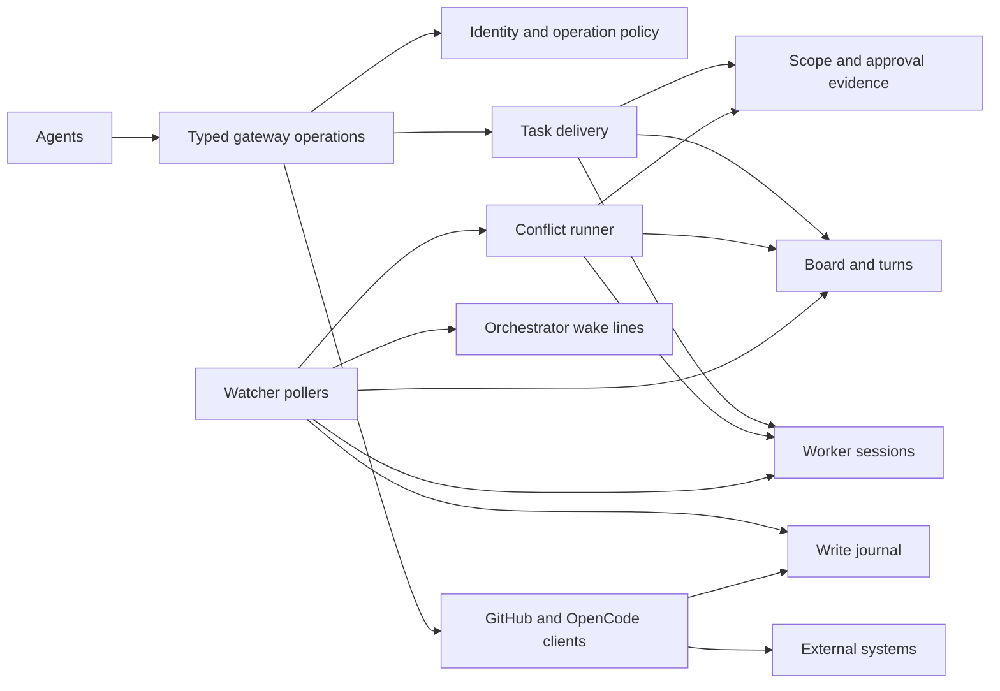

# vmethod architecture

Use this reference to understand the current architecture: its concepts, boundaries, durable state and incident-tested constraints.

Read [distribution and configuration](#distribution-and-configuration) for installation boundaries, the [concept model](#concept-model-and-state-ownership) for ownership, [interactions](#interactions) for cross-concept flows, the [module map](#delivered-module-structure) for code locations, and [invariants](#invariants-and-their-incident-evidence) and [load-bearing behaviours](#load-bearing-behaviours) before changing a feature.

## Changing the architecture

This document is the reference for further features, not a frozen design. An issue whose specification changes the architecture must name the change and justify it. The orchestrator flags that change and justification to the owner in the SCOPE REVIEW summary. A worker who finds that the agreed specification needs an architecture change posts DESIGN rather than making it.

## Distribution and configuration

vmethod is the shared methodology and tooling used by project orchestrators and workers. Consumers pin **`@vworlds/vmethod`** exactly as an npm devDependency and retain their project-specific settings locally. The package requires Node ≥ 24 and ships documentation, schemas, migrations, templates, source and a readable, unminified ESM bundle with sourcemaps. Runtime libraries are bundled; Markdown/Mermaid checking loads the optional `jsdom` and `mermaid` peers on demand. Mermaid is pinned to the package's exact renderer version; missing peers and mismatches are reported rather than silently skipping checks (`src/check.ts check`, `src/gateway/markdown.ts checkMarkdown`).

Run `vmethod <verb>` through the installed PATH launcher. It resolves the checkout and runs its local install; in vmethod's own checkout it runs `dist/vmethod.mjs`. Generated stubs run the checkout's `node_modules/.bin/vmethod`, refuse a missing install and never download a replacement (`src/registry.ts launcher`, `stub`). `init` replaces only marked stubs. Workers run in worktrees of a separate `workerCheckout`, not the orchestrator's checkout, and preparation installs dependencies before starting the session (`src/gateway/worker-launch.ts WorkerWorktrees.prepare`).

The running package can replace itself during merge follow-up. The build is one bundle without split chunks (`scripts/build.mjs`); dependency reinstall is the last follow-up step, after state and board writes (`src/tasks/merge.ts TaskMerge.mergeDelivery`). State and caches belong under the OS user's state/cache roots, never `node_modules`. Worktree scratch files and thread snapshots belong in ignored `.tmp/`.

Three owner-controlled project files parameterise the package:

| File | Responsibility | Owning implementation |
| --- | --- | --- |
| `vmethod.yaml` | Repository, base/release branches, worker checkout, board, branch conventions, checks/hooks, post-merge install, changelog, state name, limits and learning privacy | `src/core/config.ts loadYaml`, `validateYaml`, `getConfig`; `schema/vmethod.schema.json` |
| `people.yaml` | Numeric identity, login, account type, role, repository bindings, system event/application allowlists | `src/gateway/people.ts PeopleFilter`; `schema/people.schema.json` |
| `models.yaml` | Model families, OpenCode provider/model IDs, owner gates, tiers, fallbacks and prices; families match board Model options | `src/core/config.ts ModelRegistry.entries`, `validateYaml`; `schema/models.schema.json` |

YAML uses 1.2 semantics and rejects duplicate keys. Schema-directed `VMETHOD_*` overrides apply to `vmethod.yaml`; `VMETHOD_BASE` and `VMETHOD_BOARD=off` are aliases (`src/core/config.ts overrides`). Validated file loads expose typed `Config`; services currently also accept the optional, indexable `ConfigInput` view, not a fully strict internal configuration contract. `src/config.ts` re-exports the configuration API. The gateway shares a lazy model registry; watcher config and people reloads occur at poll boundaries and retain the last valid version on invalid edits.

Configuration holds no credential values. The server reads the gh login from `GH_CONFIG_DIR`, git credentials from the checkout environment and OpenCode endpoints/credentials from `OPENCODE_*`. `credentials.sshKey` names an environment variable. The gateway does not read `GH_TOKEN`. See [security](security.md), [adoption](adoption.md) and [package commands](package.md) for operational details.

Project-specific verification runs through `scripts/vmethod-hooks/verify`, with a credential-filtered environment and retained logs (`src/gateway/verify-hook.ts runVerifyHook`). Integration verification requires that hook; conflict verification reports an absent hook and skips only local verification, never the independent green-CI gate (`VerificationService`, `verifyConflictHead`).

## Concept model and state ownership

### Identity and trust

`PeopleFilter` decides who is speaking before content is relayed. Pins match numeric ID, account type and login; an edited item belongs to its verified editor. Repository bindings make a peer project's orchestrator a collaborator here. `src/identity/token.ts TokenAuthentication.authenticate` authenticates the token viewer, cached per gateway instance; `src/identity/policy.ts authorizeGateway` applies operation and own-task policy. The environment may narrow authority, never elevate it; task-scoped calls require a worker token. Dropped metadata is recorded by `src/gateway/digest.ts Digest`, without exposing unknown authors' bodies.

### Gateway boundary, transport and clients

The CLI calls typed `Operations` through `Transport`; the shipped transport is in-process (`src/gateway/transport.ts inProcess`, `context`). `src/gateway/server.ts createGateway` and `GatewayServices` compose lazy services, handlers and authentication. Credentials and raw external responses stay behind this operation seam.

`src/gateway/client.ts GitHubClient` owns strict HTTP/GraphQL handling, retries, budget headers, secondary-limit pauses and successful-write journaling; `OpencodeClient` owns sessions, messages, permissions, usage and worktree access. `src/gateway/git.ts GitTransport` owns classified git transfers and merge previews. The boundary also owns Markdown/closing-keyword checks and filtered diagnostic reads (`src/gateway/markdown.ts`, `src/github/diagnostic.ts`). Budget and pause state are process-local; poll retries go to `watch-retries.log`, not the wake stream.

This is a logical trust boundary, not yet an OS-isolated credential server. Owner-installed permission rules keep agents on the wrappers; agents do not install or change those rules. A separate MCP transport/credential-holding process is not implemented. It can attach to the operation seam without moving policy into CLI verbs.

### Board and turns

The GitHub project is workflow state. Its seven columns are Backlog, Scoping, Spec review, Executing, Owner review, Approved and Done (`src/board/runner.ts workflowColumns`). Progress and management assignment express whose move it is; worker assignees are preserved. `src/core/progress.ts` owns the grammar, expected turn and replacement guards; `src/gateway/turn.ts` applies turn assignment. `src/gateway/board.ts BoardService` owns repository-scoped writes, issue-side membership reads, ordered field batches and position hooks.

Status changes carry Progress first in the same mutation; verbs set assignees before the board move. Executing is activity-ordered at the top; Owner review receives handovers at the bottom. Other columns remain owner-ordered. Linked issues stay Executing without mirrored owner turns; delivery review lives on the PR. Estimates belong to issues, not PRs; task opening freezes `points_open`, grading writes the final issue Estimate.

The board README stores version, compatibility, lock, aliases and resumable migration state. `src/board/readme.ts` and `src/board/runner.ts MigrationRunner` own that block; migrations in `board/migrations/` are append-only, idempotent, locked and verified. Expand/contract migrations support consumers pinned to different versions; contract operations wait for adoption across configured board repositories. Ordinary operations are repository-scoped; migrations alone act board-wide. Done retention keeps six cards across repositories while each repository archives only its own. See [board](board.md) for the schema and migration protocol.

### Scope and approval evidence

`src/evidence/` answers whether scope, delivery, delegation, model use or summons release is proved. Pure readers consume authenticated GitHub history; `EvidenceReader` gathers reviews, timeline events, comments, body hashes and recorded field creators through the existing gateway helpers. A card's Status is not approval. Missing evidence can be `unknown`, never implicit permission.

Evidence is recomputed, not stored as a local permission flag. The local `.tmp/issue-read-<n>.sha256` is only a stale-read guard for issue edits. Approval carry and conflict proofs live in `clean-base.ts`, `carry-approval.ts` and `conflict-proof.ts`. See [scope review](orchestrator-guide.md#scope-review) and [approval and testing](gateway.md#approval-and-testing).

### Task delivery

`src/gateway/task-flow.ts TaskFlow` delegates to `src/tasks/{open,review,merge,link}.ts` and `src/conflicts/cards.ts`. `src/tasks/common.ts TaskCommon` supplies shared reads/writes. Task markers and relations have one decoder in `src/tasks/markers.ts`; PR headers and structured markers hold issue relations, opening points, model overrides, delegation copy proof and holds.

Delivery applies scope, owner/model/delegation, current-head CI, base, conflict and worker-stop gates in order. `src/gateway/checks.ts ChecksService` owns CI evidence; `src/gateway/verify.ts VerificationService` owns integration verification and refresh-checks. Push policy remains in `src/gateway/handlers/push.ts push`. Merge follow-up persists `merge-<pr>.json` so interruption and owner button-merges can resume idempotently. Read snapshots remain in `.tmp/`.

### Worker sessions

`src/gateway/workers.ts WorkerService` runs one OpenCode session per task PR, with worktree preparation in `WorkerWorktrees` and guarded cleanup in `WorktreeService`. `src/gateway/worker-prompt.ts` builds onboarding. `src/sessions/lifecycle.ts plan` computes ordered effects and lazy observations; `WorkerService` executes them. `src/sessions/usage.ts` handles segment/request accounting with `src/cost.ts`.

`workers/<pr>.json` stores the session, directory, model, usage segments/baselines, pending wakes and conflicts, conflict send time, quota stop/resume, captured usage and grading/finalisation flags. `<pr>.wake` persists lock-contended wakes; `<pr>.lock` serialises operations; `quota-<family>.json` records quota failures. `.vmethod/.env` scopes the task worktree. A fresh session receives onboarding; a live one receives fixed PR-reading wakes, not another first prompt. Conflict drains precede ordinary wakes; quota recovery uses structured errors and eligible approved fallbacks.

### Conflict resolution

`src/conflicts/machine.ts step` is the pure transition policy; `src/gateway/conflicts.ts ConflictService` holds the lock, gathers observations and executes ordered effects. `src/conflicts/cards.ts ConflictCards` owns card snapshots, conflict turns, restoration and escalation. `WorkerService` selects and runs fixers; `src/watch/pulls.ts PullPoller` drives reconciliation.

`conflicts/<pr>.json` stores head/base, files, resolution step, phase (`starting`, `waiting`, `resolved`, `blocked`, `merged`), prior card and dispatch/restore flags. The per-PR lock names its process identity. Watcher markers record conflict/base dispatch and results. Fresh head/base reads precede dispatch; clean merge or conflict-hunk/lockfile proofs, CI, verification and a final snapshot precede acceptance. Dispatch and restore preserve a live Approved card rather than overwriting an owner decision.

### Watcher event loop

`src/gateway/events.ts EventLoop` owns the single-reader lock, ordered poll steps, failures, pacing, pending/quiet/once batching and delivery acknowledgement. `src/watch/comments.ts CommentStream` owns comments and protocol memory. `BoardPoller`, `PullPoller` and `WorkerPoller` own board reconciliation, pull/conflict driving and worker/cost/quota observation respectively. Pollers receive narrowed host services, typed state and explicit callbacks, not an `EventLoop` instance. Pull details and worker sessions share a six-cycle cadence.

The watcher shadows GitHub under `$XDG_STATE_HOME/vmethod/<stateName>` to distinguish news from noise. `src/watch/state.ts` exposes `PrState`, `CardState` and `LoopState` over the existing marker files: open/head/branch/CI/activity/review/protocol/prompt/conflict/cost/progress markers, board column/assignee/absence baselines, cursor, listing baseline, mutes and tracks. `pending.json`, `quiet`, `delivered.jsonl` and `writes.jsonl` support restart-safe delivery and attribution. These are observation/delivery state, not a replacement for the board or approval history.

### Journals and locks

`src/gateway/write-journal.ts WriteJournal` records successful writes at the client boundary, matches own writes, marks in-flight operations and attributes pushed heads. `writes.jsonl` retains 24 hours. It is the shared attribution seam between independent verbs and watcher processes; verbs do not write watcher protocol markers directly.

Lock policies deliberately differ. `src/journal/locks.ts OwnedLock` uses PID/start-time identity for watch/conflict locks; `DirLock` never automatically removes worker, learning/generation or verification claims. Worker claims name their holder. The write journal uses `PidLock`: only a file older than three seconds whose PID returns ESRCH is reclaimed; a reused live PID remains locked. The board field lock stays in `MigrationRunner`, with host/boot/PID/start identity, a holder-less initialization window and explicit recovery. See [lock policies](locks.md).

### Shared learnings

`WorkerService.grade` validates a delivery record before writing the issue Estimate and staging `.vmethod/model-log.jsonl`. `src/learnings.ts` owns the shared schema; `src/gateway/learnings.ts LearningsService` owns submission, union, reports and reads. Central records live in `learnings/models/**` and `learnings/notes/**`; `learnings.json` is a local receipt, not the authority for novelty. Policy/check/merge and annotation generation remain gateway modules.

Submissions are add-only fork PRs from centrally bound orchestrators. Private reduction rebuilds allowed fields, retaining only cleared information. Missing telemetry is null, not fabricated zero. Generated annotations come from a tool-denied session with allowed source URLs and are not automatically committed. Learnings are advice, never approval or policy: consumers can read current central pages while releases bundle an offline snapshot. See [learnings](learnings.md).

### Releases

`src/gateway/release.ts releaseNext` dispatches publishing from a base branch at the remote head. `scripts/{changelog,release-notes,publish}.mjs` collect fragments and publish; learning merge is a pre-release operation. Tags, GitHub releases, npm dist-tags and `package.json`'s `boardVersion` are release state. Publishing uses trusted identity/provenance, not registry tokens. Consumer upgrades review release notes and package diff, update the exact pin/lockfile and run board migration. See [change process](change-process.md).

## Interactions

- **Turns cross delivery, watcher and conflict boundaries.** Shared Progress policy determines management assignment; ordered writes and the two-minute operation window keep a poll between writes from reporting a violation. `TaskReview.review`, `BoardPoller.applyProgress`/`reconcileTurn` and `ConflictCards.cardRestore` are different callers of that policy.
- **Approval and card preservation answer different questions.** `EvidenceReader.approvalFor` proves permission for a head; conflict card restoration reads live Status to preserve an Approved move, not to manufacture approval. Delegation is checked at the time of the relevant action and again before writes. Incidents #244, #245 and #274 exposed this overlap.
- **Wakes cross review, hold release, worker polls and fixers.** Review/release create fixed notifications, busy sessions queue, conflict drains run first, and owner summons/merge deliberately clear wakes. `plan` and `filterStaleWakes` retain the ordering learned from #105, #181, #193, #331 and #373.
- **Watcher markers shadow protocol position; GitHub remains authoritative.** Comment memory and worker-round readers serve different observation contexts. Thread snapshots separate content hashes from state-line hashes so a changed head does not re-deliver an unchanged task body.
- **The journal attributes, it does not approve.** Exact comment IDs or bounded field/value/time matches distinguish this session's writes from a sibling's. Operation records hide only in-flight bookkeeping, and pushed-head records attribute activity. Unknown or unmatched writes are reported, not discarded.

## Delivered module structure

Paths below describe the implemented modules, not a target tree. Exported declarations in the named source files own exhaustive signatures.

| Area | Modules and public responsibilities |
| --- | --- |
| `src/core/` | `protocol.ts`: tags, parsing, headings and wake texts; `progress.ts`: grammar, expected turn and replacement guards; `time.ts`: named windows; `config.ts`: validated files/types and model registry |
| `src/identity/` | `token.ts`: `TokenAuthentication`; `policy.ts`: `authorizeGateway`. `PeopleFilter`, digest and token acquisition remain under `src/gateway/` |
| `src/github/` | `pages.ts`: fail-closed `pages`, `batchPages`, `pageCursor`; `selections.ts`: shared GraphQL fields; `diagnostic.ts`: filtered diagnostic values |
| `src/journal/` | `locks.ts`: `OwnedLock`, `PidLock`, `DirLock`; the board field lock remains in `src/board/runner.ts` |
| `src/board/` | Estimates, migration loading/types, README state and `MigrationRunner`; migration artefacts are in `board/migrations/` |
| `src/evidence/` | Scope, approval, autopilot, model gates, owner agreement, three separate proof modules and `EvidenceReader` |
| `src/tasks/` | `TaskCommon` in `common.ts`; markers; `TaskOpen`, `TaskReview`, `TaskMerge` (including close and follow-up), `TaskLink` |
| `src/sessions/` | `lifecycle.ts`: pure `plan`, `staleWakes`, `filterStaleWakes`; `usage.ts`: usage accounting. Session storage, locking, quota/model selection and grading remain in `WorkerService` |
| `src/conflicts/` | `machine.ts`: `Resolution`, `Observation`, ordered `Effect` and pure `step`; `cards.ts`: `ConflictCards`. I/O runner stays in `ConflictService` |
| `src/watch/` | `state.ts`: typed markers, PR/card/loop state; `comments.ts`, `board.ts`, `pulls.ts`, `workers.ts`: concept pollers |
| `src/gateway/` | `server.ts`: composition root; `transport.ts`: operation seam; `handlers/`: thread, issue, board, push, task, worker, watch, diagnostic and learning adapters. Clients, git, board/worker/conflict services, `TaskFlow` facade, loop/delivery/pacing, checks/verification, learnings and releases stay here |
| `src/cli/` | CLI parsing, operation calls and rendering; no client-supplied permission booleans replace server-side gates |

The conflict machine returns ordered effects and continuation stages, not a second I/O implementation. Session plans similarly request lazy observations after ordered effects. Typed watcher markers preserve on-disk names/content; completed PR cleanup includes the delivered protocol/worker/cost/dispatch markers. The board writer shares issue-side membership within a multi-field operation and avoids redundant reads without changing mutation order.

## Invariants and their incident evidence

Each stable ID records a rule, the incident/design that taught it and its current enforcement locations. Locations name files and functions, never drifting line numbers. Preserve these constraints when extending the architecture.

### Identity and trust

| ID | Invariant | Taught by | Enforced at |
| --- | --- | --- | --- |
| I1 | Token pins confer authority; environment only narrows; task-scoped calls require a worker token. | #66 (PR #67) | `src/identity/token.ts TokenAuthentication.authenticate`; `src/gateway/transport.ts context` |
| I2 | Tags, display/commit names and card Status confer no authority; match ID, type and login pins. | design #2, #19 | `src/gateway/people.ts pinnedIdentity`; `src/github/diagnostic.ts filterDiagnosticValue` |
| I3 | Orchestrator authority is per repository; peers cannot amend, answer, release holds or take turns here. | #186 (PR #196), #201 | `src/gateway/people.ts PeopleFilter.roleIn`; `src/gateway/turn.ts turnAssignees`; `src/watch/comments.ts CommentStream.processComment`; `src/evidence/scope.ts orchestrates` |
| I4 | Edits belong to verified editors; unverifiable edits fail closed; edited REST text is not instruction authority. | #19, #53 | `src/gateway/people.ts PeopleFilter.accept`; `src/github/diagnostic.ts filterDiagnosticValue`; `src/watch/comments.ts CommentStream.processComment` |
| I5 | Drop unknown authors before body fetches; scope/delegation readers filter metadata first; record dropped metadata. | design #4, #45 (PR #53) | `src/gateway/handlers/threads.ts collection`; `src/evidence/scope.ts ScopeReader.read`; `src/evidence/autopilot.ts AutopilotReader.records`; `src/gateway/digest.ts Digest.drop` |
| I6 | System identities yield structured facts, checked by application ID, not check name or free text. | design #2 | `src/gateway/people.ts PeopleFilter.check`, `checkFacts`; `src/gateway/checks.ts ChecksService.runs` |
| I7 | Use the checkout's gh login in `GH_CONFIG_DIR`, never `GH_TOKEN`. | #285 | `src/gateway/github-token.ts githubToken`; `src/check.ts check` |
| I8 | Worker post/wait/push writes are restricted to its own task PR/repository. | #7, #23 | `src/identity/policy.ts authorizeGateway`; `src/gateway/handlers/push.ts push` |

### Gateway boundary

| ID | Invariant | Taught by | Enforced at |
| --- | --- | --- | --- |
| G1 | Journal only successful complete writes; refused/partial GraphQL mutations never stamp. | #55 (PR #56), #113 | `src/gateway/client.ts GitHubClient.rest` |
| G2 | Budget comes from headers, never `rateLimit.remaining`; pause before reserve; polls raise rather than sleep. | design #2, #6, #364 | `src/gateway/client.ts GitHubClient.request`; `src/gateway/watch-pacing.ts WatchPacing` |
| G3 | Poll retries log instead of printing; exhaustion still surfaces. | #273 (PR #277) | `src/gateway/client.ts GitHubClient.note` |
| G4 | Invalid shapes, missing connections and bad pagination cursors throw, never become empty success. | tooling rules, #45 | `src/github/pages.ts pages`; `src/gateway/board.ts nextCursor`; `src/gateway/handlers/threads.ts collection` |
| G5 | Credentials/raw responses stay behind the seam; subprocess environments are allowlisted. | design #4, #285 | `src/gateway/git.ts GitTransport.localEnvironment`; `src/gateway/lockfile.ts npmCiEnvironment`; `src/gateway/worker-launch.ts WorkerWorktrees.git` |
| G6 | Posts pass Markdown/closing-keyword guards; worker headers are not duplicated; file text has no added footer. | #4, #268, #266 | `src/gateway/markdown.ts checkMarkdown`, `guardClosingKeywords`; `src/gateway/handlers/threads.ts post`; `src/gateway/worker-verbs.ts workerVerb` |

### Board and turns

| ID | Invariant | Taught by | Enforced at |
| --- | --- | --- | --- |
| B1 | Status carries Progress in the same ordered mutation, Progress first; verbs write assignees first. | PR #178, #199 (PR #235) | `src/gateway/board.ts BoardService.set`, `setFields`; `src/tasks/review.ts TaskReview.review` |
| B2 | Owner Progress holds owner; worker handoffs/verifying hold orchestrator; working clears management turns. Housekeeping falls back to owner for empty/stuck/unknown states in review columns; watcher reconciliation leaves unspecified turns untouched. Preserve worker assignees. | PR #79, #257 (PR #259) | `src/core/progress.ts expectedTurn`, `reconciledTurn`; `src/watch/board.ts BoardPoller.reconcileTurn`; `src/gateway/board.ts BoardService.setAssignees`; `src/gateway/turn.ts turnAssignees` |
| B3 | Record multi-field operations before writes; watcher turn/delegation checks skip the two-minute in-flight window. | #199, #249, #253 | `src/gateway/write-journal.ts WriteJournal.beginOperation`, `recentlyWrote`; `src/watch/board.ts BoardPoller.watchAutopilot`, `reconcileTurn` |
| B4 | Current card Status is never approval; authenticate historical owner actors/reviews. | design #17, #19 | `src/evidence/approval.ts isOwnerApproved` |
| B5 | Own handover Progress is applied once per comment, not on each overlapping reread. | #126 (PR #127) | `src/watch/comments.ts CommentStream.processComment` |
| B6 | Empty Status with a column baseline is unknown for that poll; prune only after three successful absences spanning 24 hours. | #216 (PR #232), #206 (PR #210) | `src/watch/board.ts BoardPoller.watchColumn`, `pruneBoardBaselines` |
| B7 | Reread listing moves before reporting; discard stale observations without replacing baseline; only authenticated newer moves cancel turns. | #164 (PR #165), #175 (PR #178) | `src/watch/board.ts BoardPoller.watchColumn`, `queueMoveCancelsTurn` |
| B8 | Owner self-unassignment returns verifying to orchestrator; plain owner comments do not release summons. | #223 (PR #224) | `src/watch/board.ts BoardPoller.watchAssignees`, `applyProgress` |
| B9 | Linked issues stay Executing without an owner mirror; owner delivery states live on the PR. | #106 (PR #109), #223 | `src/watch/board.ts BoardPoller.clearStaleOwnerMirrors`; `src/tasks/review.ts TaskReview.review` |
| B10 | Reorder Executing to top and Owner review handovers to bottom only; position writes are best effort. | #238 (PR #240) | `src/gateway/board.ts BoardService.moveToTop`, `moveToOwnerReviewBottom`, `orderAfterEntries` |
| B11 | Ordinary writes reject foreign/draft cards; migrations alone are board-wide; Done keeps six across repos. | design #5, #87 | `src/gateway/board.ts BoardService.scope`, `capDone`, `ensureCard` |
| B12 | Migrations are append-only, locked, idempotent, verified and never downgrade; preserve option IDs and verify card values. | #22, #83, #234, #252, #258 | `src/board/runner.ts MigrationRunner.migrate`, `preserveOptions` |
| B13 | Archived field changes go through journaled unarchive/set/archive/verify, never a direct write. | #258, #267 (PR #269) | `src/gateway/board.ts BoardService.setArchivedCard`; `src/board/runner.ts MigrationRunner.finishArchivedMove` |
| B14 | Membership/per-item writes read issue-side relations; project listings are for board-wide scans. | #168 (PR #188), #287 (PR #296) | `src/gateway/board.ts BoardService.issueSideItem`, `setIssueFields` |

### Scope and approval evidence

| ID | Invariant | Taught by | Enforced at |
| --- | --- | --- | --- |
| S1 | Normal scope approval requires an owner Spec review → Executing move newer than the latest body-matching SCOPE REVIEW; the trivial shortcut uses Scoping → Executing. Explicit configured fast-path/delegation routes still require a matching review. | #138 (PR #140), #223 | `src/evidence/scope.ts scopeApproved` |
| S2 | Body edits void scope approval and warn at edit time. | #359 (PR #375), #341 | `src/gateway/handlers/issues.ts issueEdit`; `src/evidence/scope.ts scopeRefusal` |
| S3 | Any non-local-orchestrator comment voids the trivial shortcut. | #138, #186 | `src/evidence/scope.ts scopeApproved` |
| S4 | Owner delivery approval binds the exact head, via review or a move Owner review → Approved after a handover naming it; edits cannot backdate handovers. | design #17, #19, #88 (PR #89) | `src/evidence/approval.ts isOwnerApproved` |
| S5 | Historical approval survives later non-owner moves; a later owner move away from Approved revokes that status-based approval. | #88 (PR #89) | `src/evidence/approval.ts isOwnerApproved` |
| S6 | Carry across base merges needs two-parent base-merge proof or approved-file proof plus certification; escalated paths never carry. | #81 (PR #82), #362, #148 | `src/tasks/merge.ts TaskMerge.mergeDelivery`; `src/evidence/clean-base.ts cleanBaseMerges`; `src/evidence/carry-approval.ts approvalCarryFiles` |
| S7 | Delegation comes from owner label events or verified copy proof, not current label presence; watcher cleanup is not revocation; missing grants are unknown. | #244, #249 (PR #250), #253 (PR #254) | `src/evidence/autopilot.ts autopilotStates`; `src/watch/board.ts BoardPoller.watchAutopilot` |
| S8 | Recheck delegation at each delegated write and immediately before merge; reserved paths/release branch are excluded. | #244, #362 | `src/tasks/merge.ts TaskMerge.mergeDelivery`; `src/evidence/reader.ts EvidenceReader.autopilotApprovalFor` |
| S9 | Gated families require owner APPROVE MODEL after the body edit, or a card Model with recorded owner creator; flags alone do not approve. | #218 (PR #220), #242 (PR #248) | `src/evidence/model-gate.ts isModelApproved`; `src/evidence/reader.ts EvidenceReader.modelApproval`, `ownerCardModel`; `src/gateway/workers.ts WorkerService.resolve` |
| S10 | Executing summons release requires quoted owner agreement after summons, or owner self-unassignment. | #223, #202 (PR #205) | `src/evidence/owner-agreement.ts ownerAgreement`; `src/tasks/review.ts TaskReview.review`; `src/watch/board.ts BoardPoller.watchAssignees` |
| S11 | Unknown never becomes approval; unknown worker state blocks merge. | #19, #118 (PR #120) | `src/evidence/approval.ts isOwnerApproved`; `src/tasks/merge.ts TaskMerge.mergeDelivery` |

### Task delivery

| ID | Invariant | Taught by | Enforced at |
| --- | --- | --- | --- |
| D1 | Normal open-task requires Executing, approved scope and on-scale Estimate; explicit exceptions are recorded. Freeze opening points once; launch never substitutes today's Estimate. | #15, #8, #76 | `src/tasks/open.ts TaskOpen.open`; `src/gateway/workers.ts WorkerService.start` |
| D2 | Task relations are structured/header data, not prose/closing keywords; dependency prose is refused. | #72 (PR #73), #207 | `src/tasks/markers.ts taskRelation`, `taskIssueNumbers`; `src/gateway/markdown.ts guardDependencyText` |
| D3 | Merge requires Approved, approval/scope evidence, exact-head green CI, mergeability/current-base evidence and stopped worker; reread head/base/worker after checks. | #27, #118 (PR #120), #133 (PR #143) | `src/tasks/merge.ts TaskMerge.mergeDelivery` |
| D4 | Follow-up is journaled, idempotent and resumable; install is last because the package replaces itself. | #37 (PR #38), #97 (PR #104), #115 (PR #119), tooling rules | `src/tasks/merge.ts TaskMerge.mergeDelivery` |
| D5 | Do not delete branches containing commits beyond the merged head; compare-and-delete. | PR #38, #141 (PR #144) | `src/tasks/merge.ts TaskMerge.mergeDelivery`; `src/gateway/worktrees.ts WorktreeService.cleanup` |
| D6 | Refuse handover/approval on conflict or active conflict record; owner handover clears wakes and stops worker. | #245 (PR #251), #193 (PR #198) | `src/tasks/review.ts TaskReview.review` |
| D7 | Worker push requires own open task branch and frozen commit; no force, no artefacts; classify failures without credential leakage. | #23, #318 (PR #321), #354 | `src/gateway/handlers/push.ts push`; `src/gateway/git.ts classifyFailure` |
| D8 | Keep draft until owner handover or delegated review marks ready. | #99 (PR #102) | `src/tasks/review.ts TaskReview.review` |
| D9 | Hold is the exact banner/title prefix; release rereads before editing and posts GO once. | #121 (PR #124) | `src/tasks/markers.ts taskHeld`; `src/tasks/review.ts TaskReview.release` |
| D10 | Absent worker record permits cleanup; recorded but unresolvable session remains cautious. | #275 (PR #279) | `src/tasks/merge.ts TaskMerge.workerAbsent`, `mergeDelivery` |

### Worker sessions

| ID | Invariant | Taught by | Enforced at |
| --- | --- | --- | --- |
| W1 | Task sessions run in OpenCode-created linked worktrees of worker checkout, never orchestrator checkout. | #285 | `src/gateway/worker-launch.ts WorkerWorktrees.prepare`, `verify` |
| W2 | Never lose a wake: queue busy sessions, persist lock contention, drain on idle; merge/owner summons deliberately drop it. | #105, #181 (PR #184), #373 (PR #377) | `src/gateway/workers.ts WorkerService.resume`, `watchStatus`; `src/sessions/lifecycle.ts plan` |
| W3 | Only a genuine later reply makes a wake stale; replies during conflict-only turns answer no wakes, including wakes queued during that turn. | #193 (PR #198), #331 (PR #345) | `src/sessions/lifecycle.ts filterStaleWakes` |
| W4 | Busy conflict turns queue, never steer; send conflict before ordinary wakes and record send time. | #148, #331 | `src/sessions/lifecycle.ts plan`; `src/gateway/workers.ts WorkerService.resolveConflict` |
| W5 | One operation per PR; worker directory lock names holder and is never automatically reclaimed. | #91 (PR #92), #338 (PR #369) | `src/gateway/workers.ts WorkerService.locked`; `src/journal/locks.ts DirLock.holder` |
| W6 | Switches start usage-baselined segments; conflict-only switches never write card Model; card-driven resumes record owner-hint. | #68 (PR #74), #137 (PR #139), #274 (PR #278) | `src/gateway/workers.ts WorkerService.changeModel`, `switchModel`, `resumeModel` |
| W7 | Session unknown is not stopped; worktree gone is stopped; status reads do not create directories. | #118, #286 (PR #289), #290 (PR #297) | `src/gateway/workers.ts WorkerService.mergeStatus`; `src/gateway/client.ts OpencodeClient.worktreeGone` |
| W8 | Capture usage before removal; grading prefers capture, then live, then stored poll; refuse only with no stored evidence, never fabricate zero cost. | #262 (PR #263), #267 (PR #269) | `src/gateway/workers.ts WorkerService.captureUsage`, `grade`; `src/cost.ts sumUsd` |
| W9 | Recover only structured quota errors; skip at-risk/quota-failed/unapproved gated fallbacks; resend interrupted prompt or queued wakes. | #358, #374 (PR #378) | `src/sessions/lifecycle.ts plan`; `src/gateway/workers.ts WorkerService.finishQuotaResume` |
| W10 | Refuse worker send on owner/orchestrator turns; guidance uses review. | #131, #223 | `src/gateway/workers.ts WorkerService.command` |
| W11 | Fresh contexts receive onboarding, live ones do not; Model comes from card, not body prose. | #136 (PR #146), #301 (PR #303) | `src/gateway/workers.ts WorkerService.firstPrompt`, `start`; `src/gateway/worker-prompt.ts workerFirstPrompt` |
| W12 | Idle without protocol reply gets at most two CHECK-INs per round, then a stop report. | #93 (PR #94), #151 | `src/watch/workers.ts WorkerPoller.pollWorkers` |

### Conflict resolution

| ID | Invariant | Taught by | Enforced at |
| --- | --- | --- | --- |
| C1 | One owned resolution lock per PR; refresh-checks holds it from snapshot through push; live holders mean quiet pending, dead holders recover. | #211 (PR #237), #373 (PR #377) | `src/gateway/conflicts.ts ConflictService.resolve`, `acquire`; `src/journal/locks.ts OwnedLock.conflict`; `src/gateway/verify.ts VerificationService.refresh` |
| C2 | Mark dispatch only after the call returns; a pending outcome without a pending record retries, as does a failed dispatch. Terminal results can be marked immediately after return. | #373 | `src/watch/pulls.ts PullPoller.reconcileConflicts` |
| C3 | Reread head/base before dispatch; moved heads retry next poll; vanished conflicts close record. | #373 | `src/conflicts/machine.ts step` stages `recheck`, `recheck-preview` |
| C4 | Dispatch/escalation/restore never move Approved away; restore rereads live card and preserves approval. | #244, #245 (PR #251), #274 (PR #278) | `src/conflicts/cards.ts ConflictCards.cardRestore`, `escalateConflict`; `src/conflicts/machine.ts step` stage `restore` |
| C5 | Accept only exact-parent/hunk or synced-lockfile proofs, green non-stale CI, verification and final resnapshot. An absent conflict verify hook is explicitly reported and skips local verification only. | #148, #368 | `src/conflicts/machine.ts step` stages `proof` through `final`; `src/evidence/conflict-proof.ts proveConflictMerge`; `src/gateway/verify-hook.ts verifyConflictHead` |
| C6 | Outside fixes/closed/merged PRs close records quietly; up-to-date PRs produce no event. | #245, #274, #295 | `src/conflicts/machine.ts step` stages `held-status`, `held-preview`, `ancestor`; `src/watch/pulls.ts PullPoller.settleConflicts` |
| C7 | Fixer comments/commits do not revive task Progress/Status while dispatched fixer owns card. | #193, #274 | `src/watch/pulls.ts PullPoller.processOpenPr`; `src/watch/comments.ts CommentStream.processComment`; `src/gateway/conflicts.ts ConflictService.fixing` |
| C8 | Update-branch accepts only clean base merges; fixer selection uses cheapest ungated priced same-backend family, skipping at-risk providers. | #148, #374 | `src/conflicts/machine.ts step` stage `proof`; `src/gateway/workers.ts WorkerService.conflictChoice` |
| C9 | Bound resolution to one hour; retry re-proves only recorded verify failure. | #148, #274 | `src/conflicts/machine.ts step` stages `deadline`, `start` |

### Watcher event loop

| ID | Invariant | Taught by | Enforced at |
| --- | --- | --- | --- |
| A1 | One reader per state directory under PID/start lock; stop verifies command line and never SIGKILLs. | design #6, #340 (PR #372) | `src/gateway/events.ts EventLoop.acquireLock`; `src/journal/locks.ts OwnedLock.watch`; `src/gateway/watch-stop.ts watchStop` |
| A2 | Acknowledge only after printing; interrupted delivery is replayable; retain deliveries seven days. | #6, #170 (PR #179) | `src/gateway/events.ts EventLoop.nextEvents`, `applyAck`; `src/gateway/watch-delivery.ts WatchDelivery.append`, `replay` |
| A3 | Once markers and occurrence IDs dedupe separately; quiet lines ride a real event; own journaled comments stay suppressed across restart. | #55 (PR #56), #69 (PR #71), #92 | `src/gateway/events.ts EventLoop.produceOnce`, `buildBatch`; `src/watch/comments.ts CommentStream.processComment` |
| A4 | Overlap comment cursor ten minutes; advance only after comment/item polls succeed; first run baselines silently. | #69 (PR #71) | `src/gateway/events.ts EventLoop.runPoll`; `src/watch/comments.ts CommentStream.pollComments` |
| A5 | Failed steps publish no partial state: retain last good PR links; prune baselines only after complete board polls. | #159 (PR #162), #206 | `src/watch/pulls.ts PullPoller.pollPulls`; `src/watch/board.ts BoardPoller.pollBoard` |
| A6 | Report identical failure once, remind hourly, report recovery once. | #91 (PR #92) | `src/gateway/events.ts EventLoop.step` |
| A7 | Watcher never runs merge follow-up; button merges remain action items until journal complete; same-account notices wait ten minutes. | #38, #115 (PR #119), #142 | `src/watch/pulls.ts PullPoller.processGonePr` |
| A8 | Run one settling poll after first pending event to batch the same action. | #6 | `src/gateway/events.ts EventLoop.readEvents` |
| A9 | NEXT excludes owner turns; held startables/fresh launches reset signature. | #320 (PR #370) | `src/watch/board.ts BoardPoller.watchNext`, `ownerTurn` |
| A10 | Board pacing uses query cost/header depletion, ten-second floor and boundary/three-poll reporting. | #364, #376 | `src/gateway/watch-pacing.ts WatchPacing`; `src/gateway/events.ts EventLoop.checkBudget` |
| A11 | Blocked cards have no reminders/reconciliation until blockers close; incomplete pages never prove closure; report UNBLOCKED once. | #280 | `src/watch/board.ts BoardPoller.waiting`, `watchBlockers` |
| A12 | Reload config/people at poll boundaries; keep last valid files on invalid edits. | #350 | `src/gateway/handlers/watch.ts reloadWatchFiles` |

### Journals and locks

| ID | Invariant | Taught by | Enforced at |
| --- | --- | --- | --- |
| J1 | Lock append/prune so no concurrent data is lost; successful writes that cannot be journaled are errors. | #101 (PR #108), #379 (PR #380, learning union) | `src/gateway/write-journal.ts WriteJournal.append`, `beginOperation`; `src/journal/locks.ts PidLock.acquire` |
| J2 | Match exact comment IDs where present, else field/value/time within two minutes; unmatched same-account writes are sibling activity. | #55, #69 | `src/gateway/write-journal.ts WriteJournal.matches` |
| J3 | Watch/conflict use PID/start; board lock includes host/boot and initialization age. Directory locks never auto-recover; journal PID-only lock requires age >3s and ESRCH, not age alone. | #211, #252, #338, #340 | `src/gateway/process-identity.ts procStart`; `src/gateway/lock-holder.ts lockHolder`; `src/journal/locks.ts OwnedLock`, `DirLock`, `PidLock`; `src/board/runner.ts MigrationRunner.acquire` |
| J4 | Structured state replacements use temp/rename and restrictive modes. Marker stamps/quiet drains retain direct writes; append paths retain their own contract. | tooling rules | `src/watch/state.ts Marker.writeText`, `stamp`, `append`; `src/gateway/workers.ts WorkerService.save`; `src/gateway/conflicts.ts ConflictService.save` |

### Learnings and grading

| ID | Invariant | Taught by | Enforced at |
| --- | --- | --- | --- |
| L1 | Validate before writes; identical regrade appends no duplicate record, differing regrade refuses; write issue Estimate, never PR Estimate. | #9, #98 (PR #111), #15 | `src/gateway/workers.ts WorkerService.grade` |
| L2 | Private reduction reconstructs allowlisted fields, never copies narrative wholesale. | #11, #41 | `src/gateway/learnings.ts privateLearning` |
| L3 | Add-only submissions require centrally bound orchestrator; central dev/open submissions determine novelty, not local receipts. | #11, #51 (PR #52), #186 | `src/gateway/learning-policy.ts` policy readers; `src/gateway/learnings.ts LearningsService.submitLocked` |
| L4 | Union fills nulls; real conflict excludes only that delivery on read and refuses write. | #379 (PR #380) | `src/gateway/learnings.ts unionRecords` |
| L5 | Advice generation is tool-denied, claims cite allowed URLs, nothing auto-commits. | #197, #200 (PR #215) | `src/gateway/learning-annotations.ts LearningAnnotations` |
| L6 | Metrics use authenticated events; absent telemetry is null, not zero. | #197, #68 | `src/learning-metrics.ts exactMetrics`; `src/cost.ts sumUsd` |

### Releases

| ID | Invariant | Taught by | Enforced at |
| --- | --- | --- | --- |
| R1 | Release dispatch requires base at remote head and run on that head; tags/releases are authoritative while npm propagates. | #308 (PR #317), #310 | `src/gateway/release.ts releaseNext` |
| R2 | Replace running package only after state/board work; build has no lazy split chunks. | tooling rules, #3 | `src/tasks/merge.ts TaskMerge.mergeDelivery`; `scripts/build.mjs` build |
| R3 | boardVersion equals last migration; contract waits for all board repositories to adopt. | #5, #22, #87 | `src/board/runner.ts MigrationRunner` constructor; `src/gateway/board.ts BoardService.adoption` |

## Load-bearing behaviours

These details can look accidental. Preserve them, or explicitly justify their architectural change through scope review.

1. The settling poll batches one action's writes (`src/gateway/events.ts EventLoop.readEvents`).
2. `WORKER_EVERY = 6` calibrates worker/commit/CI reads and stale/silent timers (`src/watch/workers.ts WORKER_EVERY`; `src/watch/pulls.ts PullPoller.pollPulls`).
3. Mark conflict dispatch after the call returns; pending without a landed record retries (`src/watch/pulls.ts PullPoller.reconcileConflicts`, #373).
4. `conflictSentAt` excludes every reply at/after it, even for wakes queued during the fixer's turn (`src/sessions/lifecycle.ts filterStaleWakes`, PR #345).
5. The two-minute operation window and recent delivery-column Status stamps both suppress in-flight violations (`src/gateway/write-journal.ts WriteJournal.recentlyWrote`; `src/core/time.ts OPERATION_INFLIGHT_MS`).
6. `beginOperation` throws if journal writing fails, before board writes (`src/gateway/write-journal.ts WriteJournal.beginOperation`).
7. Failed/partial responses never stamp the journal (`src/gateway/client.ts GitHubClient.rest`).
8. Status-based delivery approval requires previousStatus Owner review; dragging Backlog → Approved proves nothing (`src/evidence/approval.ts isOwnerApproved`).
9. Keep unknown distinct from both false and true for approval, worker and delegation evidence (`src/evidence/approval.ts isOwnerApproved`; `src/evidence/autopilot.ts autopilotStates`; `src/gateway/workers.ts WorkerService.mergeStatus`).
10. Owner comments queue verifying on task PR and linked issues; the owner-pause gate still applies (`src/watch/comments.ts CommentStream.processComment`; `src/watch/board.ts BoardPoller.applyProgress`).
11. Owner self-unassignment releases a summons; ordinary comments do not (`src/watch/board.ts BoardPoller.watchAssignees`, #223).
12. The card Model's recorded creator is gate evidence (`src/evidence/reader.ts EvidenceReader.ownerCardModel`).
13. Issue-side membership is authoritative, not lagging listings (`src/gateway/board.ts BoardService.issueSideItem`, #168, #206).
14. Baseline pruning requires both three absences and 24 hours (`src/watch/board.ts BoardPoller.pruneBoardBaselines`).
15. Discard stale listing moves rather than adopt the reread value as baseline (`src/watch/board.ts BoardPoller.watchColumn`).
16. Preserve assignees → Progress → Status order and the owner-paused apply gate (`src/tasks/review.ts TaskReview.review`; `src/gateway/board.ts BoardService.setFields`; `src/watch/board.ts BoardPoller.applyProgress`).
17. Nothing-to-resolve produces no watcher event (`src/watch/pulls.ts PullPoller.settleConflicts`).
18. Conflicting PRs refuse owner handover before any write (`src/tasks/review.ts TaskReview.review`).
19. Worktree gone is stopped; session unknown is not (`src/gateway/workers.ts WorkerService.mergeStatus`).
20. Capture usage before removal; grading refuses only if no stored usage remains (`src/gateway/workers.ts WorkerService.captureUsage`, `grade`).
21. Conflict-only model switches leave card Model intact (`src/gateway/workers.ts WorkerService.switchModel`).
22. Cleanup fetches missing pull heads before containment and uses `update-ref -d <branch> <head>` compare-and-delete (`src/gateway/worktrees.ts WorktreeService.cleanup`, `fetchMissing`).
23. Dependency reinstall is the final awaited follow-up step (`src/tasks/merge.ts TaskMerge.mergeDelivery`).
24. Headers supply budget; `rateLimit.cost` is only telemetry (`src/gateway/watch-pacing.ts WatchPacing`; `src/gateway/watch-board.ts WatchBoard.query`).
25. Pagination fails closed rather than silently truncate (`src/github/pages.ts pageCursor`, `pages`, `batchPages`).
26. Thread snapshots hash the state line separately from content (`src/gateway/thread.ts saveThreadSnapshot`, #284, PR #291).
27. REMINDER (owner rule) is delivery metadata, not an acknowledged/replayed event (`src/gateway/events.ts EventLoop.chatReminder`).
28. Poll retries log rather than stderr: monitor lines become orchestrator wakes (`src/gateway/client.ts GitHubClient.note`).
29. Stubs and launcher never download an unpinned replacement (`src/registry.ts stub`, `launcher`).
30. Invalid people reload keeps the previous list; missing delegation grants stay unknown (`src/gateway/handlers/watch.ts reloadWatchFiles`; `src/evidence/autopilot.ts autopilotStates`).

## Toolchain and verification

TypeScript strict checking, esbuild bundling, Vitest, ESLint/typescript-eslint, Prettier, Husky/lint-staged and Knip are configured in `package.json` and the repository tool configs. Tests inject fetch/exec and fail-loud fakes for gateway behaviour; integration/launcher and packed-install smoke checks also exercise real local child processes. No live GitHub credentials are needed for tests. `scripts/smoke.mjs` installs the packed bundle into a fixture consumer and checks it there.

Run the project's configured `checks.verify` recipe and task-specific gates; see the [worker guide](worker-guide.md#checks-and-submission). Keep behavioural assertions, hostile-input coverage, bounded timeouts and explicit failure evidence. Public operation signatures live in source; [gateway](gateway.md), [board](board.md), [security](security.md), [protocol](protocol.md) and the role guides own operational instructions. Consumer routing stays local: `AGENTS.md` points to pinned package guides plus project-specific engineering rules.
